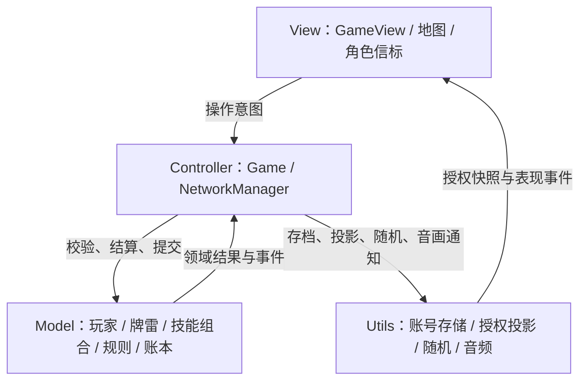
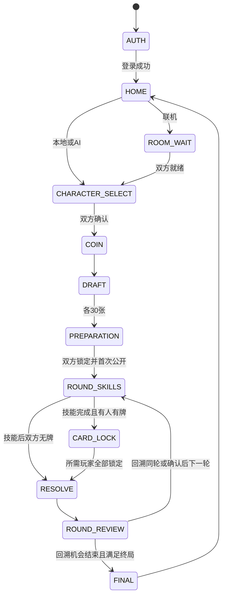
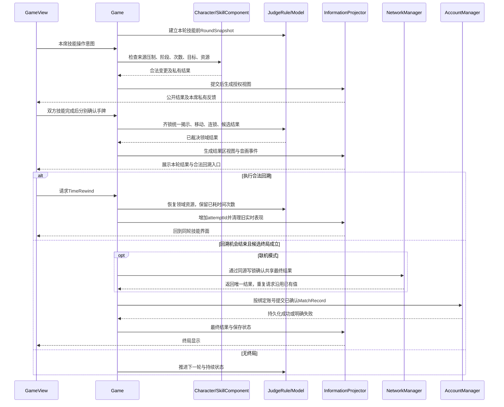

> 2026-10-29 用户确认的迭代4增量口径：选牌采用用户提供的石头/剪刀/布图片，并在各选牌区实时公开对应库剩余数（覆盖下文“仅公开总数/不公开分项”的旧约束）。硬币正反面不再固定绑定P1/P2，双方可改选、自动互补分配，公平落面匹配先手。交替一人一张、交接清屏及各取30保持不变。

# 《40阶登山博弈游戏》系统设计说明书

| 文档属性 | 内容 |
| --- | --- |
| 版本 | v1.4（原生Web 2.5D与角色名字铭牌/元素信标） |
| 日期 | 2026-10-29（Asia/Hong_Kong） |
| 所属阶段 | 第三阶段：系统设计 |
| 状态 | 第7步（迭代1）已实现并保留；第8～16步按原生Web 2.5D方案实施 |
| 需求依据 | [需求分析 v1.2](01-requirements.md)、[已确认的系统分析及规则勘误](02-analysis.md)、[分析类图](02-classdiagram.puml)，以及本轮系统设计要求 |
| 本次交付 | 仅同步原生Web 2.5D设计与计划；后续功能按迭代实施与验收 |

## 1. 设计依据、覆盖关系与技术选择

### 1.1 规则来源的优先级

采用“本轮用户明确要求 → 已确认系统分析中的最新规则勘误 → 需求 v1.1 中其余有效条款”的顺序。前两阶段文件保留原文，本设计不声称旧需求条款已经同步改写。以下三项采用最新确认口径：

| 事项 | 本设计采用口径 | 对应旧表述的处理 |
| --- | --- | --- |
| 单向出牌 | 对手无牌而本人出牌时，计当轮获胜；风剪刀4步、岩石头6步、水布5步照常生效。火系计入连胜，第2次及以后连续获胜额外+2并焚毁本次选中的落脚雷；平局或失败才中断连胜 | 覆盖需求中“单向不算获胜/连胜”的旧表述；不扩大为水系失败摸牌。冻结仅剩一种牌时的基础减半仍只用于双方实际猜拳获胜，不应用于单向推进 |
| 生命抽牌余量 | 普通兑换须公共库至少2张且取2；LifeExchangeBonus 也至少须2张，余2取2、至少3取3，余0/1拒绝且不扣雷；LifeReplenish 在原手牌/次数/压制条件满足且库非空时取至多3张，余1/2取尽，空库拒绝且不扣次数 | 覆盖需求中“生命不足3张整笔拒绝”的旧表述；融合角色使用同样边界 |
| 地图布局 | 按用户最新确认，采用笔直向上的0～40阶立体天梯；白昼天空岛风格、三段地貌、云海粒子、终点门/王座和平滑跟随共同呈现 | 与前两阶段已确定的笔直天梯一致；阶数、步数、布雷范围及落脚判定保持既定规则 |

不增加聊天、观战、公网匹配、云账号、外部数据库、未完局存档、断线续连或新的角色技能。本次调整第8步（迭代2）至第16步（迭代10）的实现技术，既定规则及逐轮人工验收流程继续适用。

### 1.2 主要技术取舍（本轮定案）

放弃Godot引擎、全3D路线与第一人称视角限制，统一采用原生Web 2.5D立体渲染技术栈：HTML5 Canvas + SVG/Canvas角色名字铭牌与元素信标 + CSS3 3D 视差光影 + Web Audio API。与第7步（迭代1）已完成的白昼天空岛首页UI及AccountManager本地账号系统处于同一前端工程，实现100%原生无缝切换。

| 设计点 | 采用方案 |
| --- | --- |
| 页面与地图 | 沿用HTML/CSS/JavaScript ES Modules与Vite；Canvas绘制透视阶梯、云海和粒子，CSS3 3D组织分层视差与光影，DOM承载HUD |
| 角色 | CharacterTokenRenderer使用Canvas/SVG绘制13名角色全名鎏金铭牌/神之眼棋子信标；图标、主题色、P1/P2角标和四类状态动画统一，无人体造型建模 |
| 控制结构 | 单一JavaScript Game与View / Controller / Model / Utils四层；统一领域规则、技能及授权投影 |
| 联机 | NetworkManager直接使用BroadcastChannel / LocalStorage；保持同浏览器同源双窗口范围 |
| 持久化 | 直接复用AccountManager、AccountProfile、LocalStorageStore、Web Crypto、Web Locks与climb40.accounts.v1 |
| 音频 | 同一Web Audio API音频管理器负责首页与游戏、六曲合成、可选MP3与SFX |

现有Three.js预览及历史证据保留作参考，不作为新2.5D方案已通过的证据。本次只更新文档，不删除文件，后续逐轮实现和验收。

## 2. 总体架构与模块职责

### 2.1 四层划分

| 层 | 主要类 | 职责 | 对外边界 |
| --- | --- | --- | --- |
| View：视图与2.5D地图/信标渲染层 | GameView、MountainMapRenderer、CharacterTokenRenderer | 复用登录/首页，DOM实现游戏HUD、图鉴与设置，Canvas/SVG实现地图、名字铭牌与元素信标、动画、交接遮罩及授权标记，CSS3 3D提供视差光影 | 仅提交意图、消费授权快照和事件，不修改牌库、暗雷、次数或战绩 |
| Controller：控制器层 | Game、NetworkManager | Game 管理状态机、命令门禁、事务和回合；NetworkManager 管理两席房间、通信定序、计时、退出与超时意图 | 统一调用领域对象；只在结果不可再回溯时请求账号记账；网络消息不能直接驱动模型任意赋值 |
| Model：数据模型与技能层 | Player、AIPlayer、Character、SkillComponent及其子类、MountainBoard、StepCell、Bomb、CardDeck、PlayingCard、JudgeRule、CardLedger、BattleLog、RoundSnapshot、RoomSession、AccountProfile、MatchRecord、Settings | 保存领域状态、执行角色能力及规则、表达资源账本、房间及账号档案值 | 不操作DOM、Canvas/SVG渲染对象、音频总线或LocalStorage；AI策略只接收自己的授权信息副本 |
| Utils：音频、账号存储与通用工具层 | AccountManager、LocalStorageStore、InformationProjector、RandomSource、GenshinAudioManager、ScoreSynthesizer、LocalMp3Source | 账号服务与持久化、权限投影、公平随机、音乐与音效播放 | 按Controller请求工作；音频不改胜负，存储不保存进行中的Game，投影不返回可修改的模型引用 |

AccountManager是保留在浏览器端的账号业务服务，放在Utils账号存储子模块；Game按第2.4节直接调用其接口，后文直接调用写法均表示这一协作关系；它对 AccountProfile、Settings、MatchRecord 执行持久化协调，但不代替 Game 推进对局。AIPlayer 继承 Player，是具有受限决策入口的领域特化对象，不形成第三席。



### 2.2 分析对象到设计对象

保留分析中的全部核心类、8个支持类、两个抽象技能中间类及20个具体技能类。新增的 GameView、LocalStorageStore、InformationProjector、RandomSource、ScoreSynthesizer、LocalMp3Source 只拆分已有页面、存储、保密、随机及音源职责，不增加用户功能。角色信标规格、曲目、地形、命令和事件采用数据规格，不额外包装为大量业务类。

Controller 单向掌握领域修改权。一次交互的标准流程为：GameView 提交命令 → Game 检查账号绑定、阶段、席位、次数、目标与资源 → 领域对象计算变更 → 校验通过后一起提交 → InformationProjector 生成公开及本人数据 → 页面、地图和音频消费结果。失败操作返回明确原因且不部分扣费。

### 2.3 同一原生Web工程结构与实现归属

沿用现有src、Vite入口和账号实现，以下路径为后续拟扩展模块，不代表已实现。

```text
src/
  main.js                         # 复用入口与内部路由
  controller/Game.js              # 复用既有控制器，扩展单一流程编排
  NetworkManager.js               # 同源双窗口通信
  view/
    GameView.js                   # 保留首页，扩展HUD/图鉴/设置
    MountainMapRenderer.js        # Canvas透视、视差与授权标记
    CameraController.js          # 第三人称跟随、全局及五焦点
    CharacterTokenRenderer.js         # SVG/Canvas全名铭牌、权能图标与席位角标
    CharacterAnimations.js
    CharacterEffects.js
  model/                          # 既有账号对象及后续领域/技能模块
  utils/                          # 复用账号存储，扩展投影/随机/音频
  resources/                      # 角色信标规格、乐谱与SFX规格
  styles/                         # CSS3 3D视差光影与界面
tests/                            # 根目录规则/集成测试与内存夹具
```

首页、游戏、图鉴、设置与音频共享同一JavaScript应用和安全档案，不创建第二套Game、账号库或音频管理器。地图与角色通过授权事件消费领域结果，不反向结算规则。

### 2.4 原生路由、账号调用与往返流程

既有五入口映射local、ai、online、guide、settings内部路由。进入时取得当前安全档案与偏好，绑定会话并挂载视图；资源准备成功才启用交互，失败保留首页和重试入口。通过同一前端路由与直接账号调用完成切换。

Game直接调用AccountManager的bindMatchOwner、saveSettings、setFusionTestUnlock、commitCompletedMatch等设计接口，按迭代扩展。视图只读publicSnapshot/InformationProjector安全副本，不接收credential、salt、派生校验值或其他账号资料。异步任务携带sessionId、requestId和绑定accountId，适用时携带matchId、revision及attemptId；拒绝过期会话、跨账号和重复提交。

对局期间冻结切号/退出账号，回写使用原绑定accountId。不可回溯终局立即请求保存，按(accountId, matchId)幂等，战绩、统计及核验后的解锁同事务更新；失败明确提示且可重试，不重复裁决。返回首页时刷新统计、锁态与设置，释放输入、动画帧、计时、订阅和私有展示，恢复原首页与天空岛视觉，不重新登录。未完局和联机退出沿用既定规则；未保存结果只在本窗口保留重试队列，不承诺刷新恢复。

图鉴与设置不产生战绩，各模式按对应迭代逐步开放；原生导航接通不等于AI或联机已完成。

## 3. 公共设计契约与数据边界

### 3.1 标识、命令和事件

| 设计记录 | 主要字段 | 使用规则 |
| --- | --- | --- |
| 对局标识 | matchId、mode、ownerAccountId、localSeat、roundNo、attemptId、revision | ownerAccountId/localSeat 从选角开始绑定；roundNo 表示业务回合，attemptId 区分同一轮回溯重演；revision 每次权威提交递增 |
| 操作命令 | commandId、matchId、seat、phase、stepToken、expectedRevision、action、payload | 相同commandId最多提交一次；过期阶段、旧stepToken或非法席位拒绝。expectedRevision 落后时按操作涉及的当前对象重新验证，不因另一方独立确认而一律丢弃有效操作 |
| 领域结果 | 是否成功、错误原因、资源变更、领域事件、私有返回值 | 领域内部记录可含牌/雷实体；不得直接序列化给界面、公开日志或AI |
| 展示数据 | PublicView、PrivateView、SkillIntelView | 由 InformationProjector 构造值副本；public 不含私有花色、对手雷库存或暗雷坐标；private 只属于指定席位 |
| 表现事件 | 事件标识、revision/attemptId、类型、允许公开或本人可见的参数 | 同一事件只播放一次；回溯后旧attempt的动画及音效队列失效；事件不能反向决定领域结果 |

不把完整 Game、Player、Bomb 或技能结果交给 View/AI/公开广播。技能按钮禁用只是反馈，真正的压制、次数和目标校验必须在Controller及领域执行路径中再次生效。

### 3.2 资源与结果不变式

1. 公共牌库＋双方可用手牌＋双方待揭示牌＋有效公开出牌历史＋秘密销毁区＝90；每张牌的 cardId 只属于一个分区。炼金改变花色后不再断言全局每种花色恒为30。
2. 本人炸弹总量＝库存＋本人场上未销毁雷，默认上限4、巴尔泽布上限5；移动/撤回不改变归属和总量，销毁后释放原所有者额度。
3. 暗选确认只扣一次；末牌进入待揭示分区后仍参与本轮。所有需出牌者统一揭示时才写入公开历史。
4. 一次落脚只处理按优先级选出的1枚雷；只有实际回退的新落脚才能继续连锁。不把经过的阶位、脚下放雷、换位或原地停留视为落脚。
5. 候选终局不写档案；本轮回溯机会结束后才提交一次 MatchRecord、统计与解锁。联机离开结果走独立终结路径且不能回溯。
6. 公开统计随实际提交刷新；对方的技能私有返回值、销毁/随机弃牌花色不进入公共日志或音效参数。

## 4. AccountManager：本地账号、战绩与解锁持久化

### 4.1 类与主要接口职责

| 类 | 职责与主要属性 | 主要方法（设计名称） | 交互流程 |
| --- | --- | --- | --- |
| AccountManager | 当前窗口的 currentAccountId、登录档案摘要、对局账号锁；依赖 LocalStorageStore，不保存Game快照 | register：验证并创建账号；login：口令校验及装载；logout/switchAccount：仅首页操作；bindMatchOwner/releaseMatchOwner：锁定/释放账号；saveSettings；commitCompletedMatch；setFusionTestUnlock；getSelectableCharacters | GameView发请求，经阶段校验后使用存储事务；登录成功通知Game进入首页；终局接收Game提供的已确认结果 |
| LocalStorageStore | 存储键、schemaVersion、同源写锁名称、当前读取版本、存储错误状态 | readEnvelope、validateEnvelope、withWriteLock、writeEnvelope、observeChanges | 在命名Web Lock内重读最新档案、修改副本、校验并一次setItem；成功后更新缓存，storage事件使其他窗口重读，不改变其登录身份 |
| AccountProfile | accountId、username、credential、stats、unlockedCharacterIds、settings、matchHistory、revision | verifyCredential、hasUnlocked、applySettings、appendConfirmedRecord、applyUnlock | 由AccountManager创建/修改；不自行访问LocalStorage；统计与历史由同一次提交更新 |
| MatchRecord | matchId、mode、ownerSeat、result、P1/P2角色、P1/P2最终阶数、endedAt、endReason | fromConfirmedResult、validate、isSameMatch | Game形成已确认结果后转换为账号视角记录；若选角未完成便联机离开，未选择角色明确记“未选择”，不虚构角色信标或解锁 |
| Settings | BGM/SFX各自音量与静音、自动切歌/循环偏好、镜头自动跟随 | validate、updateAudio、updateCamera、toPreferences | AccountManager按账号保存；GameView/播放器读同一份值；当局手动锁曲、播放进度、音频文件和最高音乐区间不放入该对象 |

### 4.2 LocalStorage 数据组织

使用一个版本化账号文档键 `climb40.accounts.v1`。其根记录包含 schemaVersion、revision、accounts；accounts 按稳定 accountId 保存账号，用户名到账号的索引由同一份记录校验或重建。这样注册索引、战绩和角色解锁不会分散成多个必须共同成功的存储键。

| 层级 | 内容 | 约束 |
| --- | --- | --- |
| accounts / 身份 | accountId、username、口令salt、派生校验值、派生算法/参数版本 | 用户名以输入校验后的完整字符串精确匹配，区分大小写；仅字母、数字、中文，2～16个字符。密码不少于4个字符，不静默裁剪密码内容；不保存明文口令 |
| accounts / 统计 | total、wins、losses、draws | total＝wins＋losses＋draws；每个matchId在同账号历史中只出现一次 |
| accounts / 解锁 | unlockedCharacterIds、融合角色当前解锁状态 | 常规12名默认可用；融合初始锁定；正常解锁与测试修改都只改当前账号 |
| accounts / 设置 | Settings列出的持久偏好 | 切号时完整切换至目标账号设置；Guest_P2和AI没有独立设置档案 |
| accounts / 历史 | MatchRecord列表，按结束时间降序呈现 | 不擅自规定最近记录条数上限；容量不足明确反馈，不静默删旧记录 |

口令派生采用浏览器Web Crypto提供的带独立随机salt的PBKDF2校验；派生参数随凭据保存，具体工作量在开发时对目标浏览器测量。界面先在100ms内给出处理中反馈，不把密码派生完成时间与完整动画时长混为同一指标。

同源档案写入使用单一命名Web Lock串行处理；锁内重读，避免两个窗口各拿旧缓存覆盖另一个账号或战绩。采用支持相应Web API的目标现代浏览器和本机可信来源运行；若能力检测或LocalStorage读写失败，明确显示失败，保留可重试的数据，不伪报注册、保存或解锁成功。不以单独比较revision冒充原子比较交换。

currentAccountId、登录是否有效、当前Game和账号锁只在各窗口内存中保存，不使用全局“当前登录账号”存储键。首次打开/刷新仍弹登录框；窗口A切号不会让窗口B的对局改绑账号。存储变更通知只刷新相应档案值，不替其他窗口执行登录或切号。

### 4.3 注册、登录、切换与存档流程

1. 注册：GameView提交用户名/密码 → AccountManager校验格式 → LocalStorageStore取得写锁并重读 → 检查唯一用户名 → 创建初始统计、12常规角色及锁定融合状态、默认设置 → 一次写入成功后回到可登录状态。注册不绕过显式登录流程。
2. 登录：按用户名查找档案并校验口令 → 成功后仅设置本窗口currentAccountId → 装载设置/战绩/解锁，Game进入HOME。错误口令不返回其他账号私有档案。
3. 切换：Game必须为HOME且未绑定有效局；校验目标账号凭据，清除上一账号的展示缓存，装载目标档案与音量/镜头设置。选角开始后直到返回首页，logout/switchAccount在业务层拒绝。
4. 开局绑定：本地/AI主账号为P1；联机房主为P1、加入者为P2。Game固定ownerAccountId与localSeat，Guest_P2/AI不创建AccountProfile。
5. 完成记账：Game确认不可回溯结果 → commitCompletedMatch在写锁内重读 → 按账号与matchId检查历史是否已存在 → 追加账号视角记录、更新一项胜负平及总数、核验解锁 → 一次持久化成功后更新界面。重发完成消息不重复记账。

融合正常解锁的完整条件为：记录属于本账号、结果为本人胜、本人本局角色恰为“黄金”莱茵多特、对手本局角色恰为“纳贝里士”。对手为融合角色、本人为Guest/AI、平局/败局、候选胜利或作废均不满足。联机加入者即使位于P2也按本人条件正常解锁；关闭端不要求被留存端代写败绩。

设置页和选角页的测试解锁/重置通过setFusionTestUnlock只改当前账号的融合角色状态，不伪造战绩、不删账号或历史。选角中重置使尚未确认的融合选择失效并要求重选；已经确定角色的对局不接受改变该角色可用性的测试修改。正常达成的解锁保持永久，显式测试重置为已确认的例外。

## 5. Game：主状态机与回合交互设计

### 5.1 主控类

Game 的主要属性为 phase、mode、matchId、ownerAccountId、localSeat、players、board、deck、judgeRule、ledger、battleLog、coinOrder、draftTurn、preparationCompleted、roundNo、attemptId、requiredActors、skillDone、cardLocks、snapshot、candidateResult、finalResult、revision、stepToken 与已处理commandId集合。业务引用由Game持有，表现层只拿投影。

主要方法包括 startMatch、confirmCharacter、tossCoin、draftCard、quickFillDraft、exchangeCardsForBomb、exchangeBombForCards、placeBomb、movePreparedBomb、recallPreparedBomb、finishPreparation、beginRound、submitSkill、finishSkillPhase、lockCard、resolveRound、requestRewind、passRewind、finalizeRound、finalizeMatch、requestRestart、abortMatch、getViewFor。方法共享第3节门禁及原子提交约定，不能由UI跳过检查直接调用Model变更。

### 5.2 状态与迁移

| 状态 | 允许的操作/进入动作 | 离开条件与去向 |
| --- | --- | --- |
| AUTH | 注册/登录；首次打开处于此状态 | 显式登录成功 → HOME |
| HOME | 选模式、查看战绩/图鉴/设置、切号/退出 | 本地/AI开始 → CHARACTER_SELECT；联机 → ROOM_WAIT |
| ROOM_WAIT | 创建/加入房间、复制码、双方就绪 | 双方就绪 → CHARACTER_SELECT；失效/离开 → HOME；未开局等待解散不产生胜负 |
| CHARACTER_SELECT | 绑定账号/席位；确定合法角色，AI可手动指定；在许可范围使用测试解锁 | 双方角色确认 → 初始化领域资源与来源压制 → COIN |
| COIN | 公平抛硬币，正面P1先、反面P2先 | 记录coinOrder → DRAFT |
| DRAFT | 当前方按花色取1牌；合法快速补齐 | 双方各30且库剩30 → PREPARATION |
| PREPARATION | 唯一普通兑换、布雷、移雷、撤雷；本人锁定后关闭本人操作 | 双方均锁定，置preparationCompleted并一次性公开规定计数 → ROUND_SKILLS |
| ROUND_SKILLS | 进入新轮时先建立技能前快照；呈现持续状态/压制，先完成双方技能操作确认 | 双方完成 → 重新计算requiredActors → CARD_LOCK；双方均无牌则直接RESOLVE |
| CARD_LOCK | 需出牌者暗选/改选，确认后扣入待揭示分区 | requiredActors全部锁定 → RESOLVE；锁末牌不改变本轮requiredActors |
| RESOLVE | 统一亮牌、账本、胜负/补牌、移动、连锁、候选结果 | 完成本轮规则结算 → ROUND_REVIEW |
| ROUND_REVIEW | 同一出牌界面展示结果；仅合法TimeRewind可在此用，或放弃 | 回溯 → 同roundNo、增加attemptId的ROUND_SKILLS；无回溯/全部放弃 → finalizeRound |
| FINAL | 不可回溯的完成结果、账号持久化状态；包括已开局联机离开产生的有效结果 | 查看结果后返回HOME；新局重新进入选角，联机重新建/入房并就绪 |
| ABORTED | 仅本地/AI未完局作废，不产生战绩 | 本地/AI重开 → 同模式CHARACTER_SELECT，退出 → HOME |

finalizeRound在无候选终局时推进至下一轮并更新持续状态；有候选终局时进入FINAL并请求存档。联机正常终局及离开终局都先由NetworkManager取得第9.2节的共享最终结果，再进入不可回溯FINAL并按本人账号记账；ROOM_WAIT尚未开局离开只返回HOME。无可用回溯的回合不新增“必须点确认”等待，完成展示后自动衔接既有流程。账号锁直至返回HOME才释放，重开回选角仍绑定原账号。



退出/刷新不列为图中任意业务捷径：由第5.7节模式专属路径终结，不能重入一次性准备阶段。

### 5.3 一人一张交替取满30张：保密交互

CardDeck初始化石头、剪刀、布各30张。DRAFT以coinOrder首方为draftTurn；当前玩家选花色后由CardDeck从该花色现存实体中取1张，交给本人Player，数量加1，再切换到对方。一次提交只能取1张；每方30张即停止接收其初选命令。这里的指定花色取牌不同于随机抽牌，不伪称花色各1/3。

选牌界面只公开牌库总数、当前轮到席位及必要进度；本人可见自己的手牌，对手所选花色、公共花色分项以及完整对手牌数栏不提前显示。本地双人每次私有操作后立即隐藏上一方手牌，显示交接遮罩，下一人确认接手后才装载自己的PrivateView；不能让上一方牌面留在底层可见。联机只发送接收方自身取牌结果及公开进度。

“快速随机补齐”保留已选牌，沿当前交替顺序逐张从剩余实体牌均匀抽取，直到双方各30张；本地/AI允许一次补齐双方。联机默认只代取本人当前轮的一张，不跳过对手；只有双方明确同意的全局补齐请求才补齐双方。此过程仍逐张转移实体、校验上限并去重，不生成两份随机库。

### 5.4 唯一开局准备阶段

preparationCompleted初始为false，仅DRAFT完成可进入PREPARATION。普通兑换/布雷/撤雷都要求处于该状态、本人未锁定；完成后该标志在后续回合及回溯中均保持已完成，不回到普通准备。

| 操作 | Game与Model的校验及提交 |
| --- | --- |
| 指定手牌换雷 | 默认耗本人2张实际可用牌；有效黄金来源首次成功仅耗1。先校验牌、总雷上限，再同时将牌移秘密销毁区、库存+1并更新首次优惠状态；失败不占优惠 |
| 库存雷换牌 | 只接受未布置库存，先校验公共库至少2张；有效生命被动取min(3,余量)，否则2。一次提交中库存-1、公共库减实际抽得数、本人手牌加对应实体 |
| 布雷 | 阶数1～39；本人有库存；库存-1、场上+1，所有者不变。同阶允许多雷，不能用“该阶有雷”拒绝普通布雷 |
| 移动/撤回 | 只允许本人本次准备已布置雷，且本人未锁；移到1～39，或撤回库存；数量/归属不变。普通调整不检查隐藏敌雷，防止错误提示泄露 |
| 准备锁定 | 单向不可撤销。保留实际手牌/库存/场上状态，不把牌数重置30；锁定后只允许查看授权信息，不再普通兑换或调整 |

兑换不设次数额度；每次仍校验牌数、总雷上限和公共库余量。默认初始3雷/上限4，雷角色4雷/上限5，死亡技能也不能突破上限。布雷不因角色在目标阶而即时爆炸。

本地双人按硬币先手完成准备并锁定 → 交接遮罩 → 后手准备并锁定。AI与联机双方独立操作，公共牌竞争由权威Game按接收、校验顺序原子提交，避免两次兑换同时占用同一剩余牌；准备阶段不另设硬币优先的等待窗口。每方准备倒计时在其当前确认步骤开始，仅联机45秒，期间兑换不重置计时；超时保留已成功操作并自动锁定，不代造新雷或兑换。

双方全部锁定前，只公开公共总数；全部锁定的同一提交才发布公共总数、三花色余量及双方手牌总数，此后随领域变化刷新。对手库存雷从不进入PublicView；己方场上雷仅按住查看时显示，松开、失焦或交接立即隐藏。

### 5.5 出牌界面与主动技能面板

同一“打出牌界面”包含状态条、技能操作区、本人手牌区、提交区和当轮结果区，不另设局外施法入口。技能区先展示来源、主被动、剩余次数、条件、压制原因；无主动技能角色显示被动说明，不生成虚构可点击技能。

为固定即时技能与公共资源冲突的次序，技能操作使用coinOrder顺序执行窗口。本地通过交接遮罩；AI/联机后手可预览静态说明和编辑本地意向，但只有轮到本人后才允许真正submitSkill、扣次数或获得侦测信息。合法即时技能提交后当场生效；本人点“技能操作完成”才进入下一方，未声明每轮一次或额外冷却。每方联机执行窗口45秒，等待对方期间不扣本人窗口时间；超时放弃尚未施放的技能并结束本人窗口。

阿斯莫代移雷在本人执行窗口中先检查仍有额度、有己雷且存在合法目的地；首次披露己方坐标才暂扣1次，窗口内重选不再扣。明确取消或超时放弃未完成移雷均走取消路径、退还暂扣并隐藏坐标；确认成功保留扣次。换位分支独立检查阶差，不能因移雷无方案禁用合法换位。

双方技能操作全部完成后，Game按此刻可用牌重新计算requiredActors：生命主动可使0牌恢复出牌，死亡主动消耗末牌可使本人跳过；双方均0牌仍完成本轮结算/回溯/终局判断。锁牌阶段不再受理新普通主动。冻结先限制合法花色，只有冻牌时允许强制出牌并记录半基础步数标记；选牌可改，确认后不可改。

本地双人的两个技能窗口全部结束后，再经遮罩分别暗选锁牌；不会在先手锁牌后才让后手追加冻结。AI/联机的锁牌独立进行，各需出牌方45秒。所有requiredActors齐锁才统一亮牌，不因某人锁末牌后可用牌变0而将其跳过。TimeRewind按钮只在本轮结果区启用，遵守专属窗口。

### 5.6 同轮结算、连锁与回溯

JudgeRule计算、Game统一提交以下顺序；表现层随后依事件播放动画：

1. 待揭示牌统一亮出并进入有效公开历史。双向判石头/剪刀/布胜负；单向出牌记为单向获胜，另一方无牌跳过，不虚构一张对手牌。
2. 处理已激活水系的实际猜拳败方摸1，空库摸0、已用次数不返还；胜、平、单向均不触发。
3. 计算基础2/3/5；实际双向获胜且被迫出仅剩冻牌时先取基础半数向上取整，再加有效角色加成。单向照常计算风/岩/水及火连胜，火第2胜起加2；平/负连胜归零。岩盾平局移动1。记录同轮双方移动计划，不先处理某席就确认胜利。
4. 普通前进只查终点；达到/超过40则逻辑停40、记录候选登顶，不再向前走。双盾平局可同轮双方到40，此时候选平局。对未登顶的落脚选1枚雷，优先敌方；同归属多雷由稳定bombId顺序作实现定序，不改变“一次只处理1枚”的业务规则。
5. 所选雷按“火焚毁 → 完整护盾免疫 → 风首次免后退 → 普通爆炸”处理。焚毁/盾均销毁该雷且不发生雷弃牌；风仍属实际爆炸，雷属于雷角色则随机弃本人可用牌1张，只有后退被免。普通爆炸销毁雷，踏雷者对手是若娜瓦则退13，否则10，最低0；雷归雷角色时附加均匀随机弃1，空手不弃负数。只有实际退到新阶才继续查雷。
6. 同轮同阶竞争同雷按coinOrder处理尚存队列，不能引爆同一雷两次；结果仍为同轮同时发生，不以处理顺序决定同时登顶胜负。原地、空间换位、脚下新放雷不触发落脚。
7. 完成所有牌、移动和雷效果，形成候选登顶或双方耗尽比高结果，进入ROUND_REVIEW。可回溯者选择使用或放弃；联机决定45秒，超时放弃。双方均无牌时仍不能越过合法回溯机会直接记账。

RoundSnapshot在本轮任何技能之前捕获：双方阶数、牌实体及花色/分区、库存雷、场雷坐标/归属、公共库、秘密销毁、有效历史、锁牌、普通技能次数、护盾/连胜/风首次/黄金优惠及临时状态。恢复后重演同一roundNo，不重复扣持续回合；盾在施放轮t及t+1有效，t+2失效，包括单向回合。

不恢复所有玩家已经消耗的时间次数、已获知信息事实、通信revision、命令去重集合和等待stepToken。回溯执行后增加attemptId、重建步骤令牌，取消旧计时器/排队意向，重新开始本轮技能窗口。两位时间角色请求同一结果时按硬币顺序只接受一次，未执行者不扣；任何已用时间次数都不因恢复快照返还。

公开日志标明本轮已回溯，被撤销的牌不计有效公开历史；旧侦测坐标不冒充当前实时雷位。玩家已知牌/情报不能要求遗忘，重抽仍按恢复后的公共库均匀不放回，不承诺与上次相同。候选登顶/耗尽可撤销，已确认前轮结果和联机离开结果不可撤销。

### 5.7 退出、刷新与重新开始

本地/AI主动退出、重新开始需二次确认：取消继续，确认将未完旧局标ABORTED且不记战绩/解锁；重开回同模式选角，重新抛币、选牌及唯一准备，重置所有局内资源、技能、持续状态、快照和音乐区间。账号档案、设置、已完成战绩及AI难度/手动角色的可编辑默认选择保留，不自动跳过选角。

刷新不恢复未完局；首次页面仍需登录。联机退出/关闭/刷新或识别断线后立即终结为留存方胜；留存客户端用最近已确认状态及本地绑定账号完成一次记账，不能依赖已关闭的房主继续运行。未完成选角的角色如实记“未选择”，不触发缺少条件的融合解锁。联机重开先按退出规则终结旧局，再重新建/入房并就绪，不提供单方面清空房内对局。

## 6. Model：数据类、规则类与技能组合详细设计

### 6.1 棋盘、牌雷与记录对象

| 类 | 职责及主要属性 | 主要方法 | 交互流程 |
| --- | --- | --- | --- |
| MountainBoard | 固定41个StepCell；按阶管理地形和部署雷，不持有相机/信标 | initialize、getCell、placeBomb、moveBomb、removeBomb、getOwnedBombs | Game/技能提交合法布置请求；JudgeRule读取落点；Renderer只读其授权投影 |
| StepCell | index、terrainZone、bombQueue；0/40禁布雷，1～39支持多雷 | addBomb、removeBomb、listBombsForRule | 由MountainBoard维护；选雷由JudgeRule执行，不向普通View暴露队列 |
| Bomb | bombId、ownerSeat、stepIndex、部署/有效状态 | relocate、markDestroyed | 准备或死亡技能建立；空间移动保留ownerSeat；爆炸/焚毁后退出原所有者总量 |
| PlayingCard | cardId、suit、当前分区 | transformSuit | CardDeck创建90张；移区由CardLedger管理；炼金仅改同一实体花色 |
| CardDeck | remainingCardIds、当前花色计数、实体索引；不负责公开时机 | initialize90、takeSuit、drawRandom、getCounts、restore | 初选指定花色，兑换/技能随机抽牌；使用RandomSource取实体，不先等概率选花色 |
| Player | seat、accountBinding或Guest/AI标识、position、handIds、lockedCardId、bombInventory、bombLimit、character、各阶段确认状态 | chooseCharacter、getUsableCards、getBombTotal、canLockCard、lockCard、applyResourceChange | Game调用阶段操作；Rule/技能使用实际状态；View只能拿本人或公开副本 |
| AIPlayer | 继承Player；difficulty、requestedCharacterId、合法观测/行动历史 | chooseCharacter、chooseDraft、planPreparation、chooseSkills、chooseCard、chooseRewind | 只将InformationProjector结果交给决策方法，再由Game验证命令；自己的实体状态不授权其策略访问对手引用 |
| CardLedger | cardZoneById、publicHistory、secretDestroyed、待揭示索引 | transfer、revealLockedCards、destroySecretly、assertConservation、capture、restore | Game事务内伴随每次牌转移更新；秘密区不进BattleLog；回溯重建实体单一归属 |
| BattleLog | 公开事件条目、roundNo/attemptId、撤销标记 | appendPublicEvent、markAttemptRewound、getPublicEntries | 仅接收InformationProjector白名单公开参数；记录实际爆炸坐标/归属，不直接记录完整Bomb/SkillResult |
| RoundSnapshot | 本轮技能前可恢复领域状态、锚点roundNo；不含不可回退信息 | capture、restoreDomainState、validateRestoration | Game建立与恢复；恢复后叠加不可返还时间次数、更新通信令牌并重新投影 |
| RoomSession | roomCode、roomId、hostSeat、两席标识、readyFlags、state、lastActivity、当前步骤期限 | reserveSeat、setReady、markStarted、isExpired、close | 由NetworkManager维护；房间就绪与Game准备锁定是不同字段，不混用 |

JudgeRule不持久化玩家状态，主要方法为 evaluateOutcome、validatePlayableCard、computeMovement、selectLandingBomb、resolveLanding、resolveBombChain、evaluateCandidateResult。输入为本轮出牌与当前领域上下文，输出供Game提交的结果及事件；核心顺序见第5.6节。它不启动动画、不写LocalStorage、不自行切Game阶段。

### 6.2 角色与技能基类契约

| 类 | 职责及主要属性 | 主要方法 | 交互流程 |
| --- | --- | --- | --- |
| Character | characterId、名称/元素、isFusion、只读信标规格、skillComponents；局内实例独立 | createForMatch、getActiveSkills、getPassiveSkills、getEffectiveComponents、captureSkillState | 选角确认后挂载新组件；与同角色对手不共享次数；信标渲染器读取信标规格，规则读取有效组件 |
| SkillComponent（抽象） | skillId、ownerSeat、sourceOrigin、isSuppressed、技能类型及局内状态 | checkSuppression、checkContext、describeState、captureState、restoreState | 所有施放/触发入口统一先检查来源压制；不能只在UI禁用 |
| ActiveSkillComponent（抽象） | maxUses、usedUses、pendingReservation、适用阶段及条件 | canActivate、validateTarget、activate、reserveUse、commitUse、cancelReservation | Game在合法窗口调用；验证完成后原子生效与计次；空间首次披露使用暂扣例外，时间技能使用结果区例外 |
| PassiveSkillComponent（抽象） | 触发条件、首次标记/持续状态等派生字段 | canTrigger、provideModifier、onDomainEvent | Rule/Game在初始化、兑换、判胜、落脚等指定钩子调用；压制组件不返回收益 |

sourceOrigin使用固定原始角色标识：BARBATOS、MORAX、BEELZEBUL、BUER、FOCALORS、HEBRIMU、VASHAKA、ISTAROTH、ASMODAY、RONOVA、NABERIUS、GOLD_RHINEDOTTIR。融合不新增覆盖来源的“FUSION”值；sourceOrigin不是当前角色名称。

### 6.3 20个具体技能类

下表“次数”为每局额度；未声明的冷却、每轮次数或其他耗费均不增加。所有类继承基类的压制、阶段和资格检查。

| 类名 / 来源 | 主要属性 | 主要方法及协作流程 |
| --- | --- | --- |
| WindScissorsBonus / BARBATOS | 剪刀获胜加步2 | modifyVictorySteps：双向胜或单向胜用剪刀时给JudgeRule加2，共4步 |
| WindFirstBombGrace / BARBATOS | firstBombGraceUsed | onSelectedBomb：本局首次实际踩雷只免退并置已用；雷销毁，雷系附加弃牌仍可发生；状态可被合法回溯恢复 |
| RockVictoryBonus / MORAX | 石头获胜加步1 | modifyVictorySteps：石头双向/单向胜加1，共6步 |
| JadeShield / MORAX | 额度1、activatedRound、有效至轮t+1 | activateShield；isActiveInRound；modifyTieMovement；protectLanding：含当轮两轮免退及雷弃牌、销毁选中雷，平局进1 |
| ThunderBombCapacity / BEELZEBUL | 初始库存4、总上限5 | modifyInitialBombs、modifyBombLimit：新局初始化生效，不因对手踩雷改变他人的上限 |
| ThunderBombDiscard / BEELZEBUL | 所属雷识别 | onActualBombExplosion：只按所爆雷owner查来源；对踏雷者可用手牌随机销毁1张，含自踩自雷；空手不弃，焚毁/完整免疫不触发 |
| NatureRecon / BUER | 额度2、施法时点情报 | detectForwardBombs、detectLargestSuit：查本人阶+1至min(39,阶+10)雷坐标，去重不附归属/同阶枚数；对手最多花色只报一种不报数量，并列固定花色顺序取一，0牌报无牌；结果只投递本人 |
| WaterVictoryBonus / FOCALORS | 布获胜加步2 | modifyVictorySteps：布双向/单向胜加2，共5步 |
| WaterDefeatDraw / FOCALORS | 额度2、activeAttempt、本轮已激活 | activateForRound、onRealDefeat：激活扣1，本轮只激活一次；真实败局抽1，空库摸0；其他结果不抽且不退次数 |
| FlameWinStreak / HEBRIMU | consecutiveWins、当前焚毁资格 | onOutcome、modifyVictorySteps、shouldBurnBomb：双向胜/单向胜均连续累加，第2胜起+2及焚毁选中雷；平/负归零，不连清同阶余雷 |
| FreezeCard / VASHAKA | 额度1、targetSeat、frozenSuit、activeAttempt | freezeSuit、filterPlayableCards、applyForcedBasePenalty：锁牌前禁指定花色；只有该花色允许强制出，真实双向胜时基础半数向上取整后再加角色加成 |
| DivineSuppression / VASHAKA | 目标来源NABERIUS | applySourceSuppression：初始化/兑换/主动/被动前持续确认对方对应来源被压制，不消耗冻结额度，不禁黄金来源 |
| TimeRewind / ISTAROTH | 额度1、不可返还的使用记录 | requestRoundRewind：仅ROUND_REVIEW请求Game恢复本轮快照；当前候选终局可撤销，已确认结果/离开判胜不可撤销 |
| SpaceOperation / ASMODAY | 共享额度2、移雷窗口标识、暂扣次数 | openOwnedBombSelection、cancelSelection、moveOwnedBomb、swapPositions：移己雷至不同且无任何雷的1～39阶，归属不变；或阶差≤5换位不触雷。显示坐标首次暂扣、取消退还、成功保留；无合法移雷方案不妨碍换位 |
| DeathRetreat / RONOVA | 对手实际退格13 | modifyOpponentRetreat：踏雷者对手持有本被动则把实际爆炸回退改13，不看雷归属；免退/焚毁不产生退格 |
| DeathCardBomb / RONOVA | 额度1 | consumeCardAndPlaceBomb：校验实际1牌、合法阶及总雷上限后，同时秘密销毁牌并直接新增本人场雷；失败不部分扣费，耗末牌后本轮可无牌跳过 |
| LifeExchangeBonus / NABERIUS | 准备兑换至多3的修正 | getExchangeDrawCount：公共库必须≥2，返回min(3,余量)；余0/1拒绝不扣雷；压制时不提供修正，Game使用普通2 |
| LifeReplenish / NABERIUS | 额度1 | replenishHand：仅ROUND_SKILLS本人执行窗口、锁牌前，可用手牌0～9且库非空时抽min(3,余量)，成功扣1次；空库/压制/无次数时拒绝 |
| GoldenFirstExchangeDiscount / GOLD_RHINEDOTTIR | firstDiscountUsed | getCardBombCost、onExchangeSucceeded：准备首次成功耗1牌，后续耗2；失败不占首次；不改普通炸弹上限 |
| AlchemyTransmutation / GOLD_RHINEDOTTIR | 额度2 | transmuteCards：选本人实际未锁定的1～2张，各指定不同于原牌的目标花色；原实体改花色，不改手牌数/公共库；提交成功扣1次 |

### 6.4 13角色挂载与融合组合

| 角色编号 / 名称 | skillComponents类型列表 |
| --- | --- |
| CH-01 巴巴托斯 | WindScissorsBonus、WindFirstBombGrace |
| CH-02 摩拉克斯 | RockVictoryBonus、JadeShield |
| CH-03 巴尔泽布 | ThunderBombCapacity、ThunderBombDiscard |
| CH-04 布耶尔 | NatureRecon |
| CH-05 芙卡洛斯 | WaterVictoryBonus、WaterDefeatDraw |
| CH-06 赫布里穆 | FlameWinStreak |
| CH-07 瓦沙嘉 | FreezeCard、DivineSuppression |
| CH-08 伊斯塔露 | TimeRewind |
| CH-09 阿斯莫代 | SpaceOperation |
| CH-10 若娜瓦 | DeathRetreat、DeathCardBomb |
| CH-11 纳贝里士 | LifeExchangeBonus、LifeReplenish |
| CH-12 “黄金”莱茵多特 | GoldenFirstExchangeDiscount、AlchemyTransmutation |
| CH-13 莱茵多特/纳贝里士 | 黄金来源的GoldenFirstExchangeDiscount、AlchemyTransmutation，加生命来源的LifeExchangeBonus、LifeReplenish，四个独立局内组件实例 |

Character与SkillComponent为整体—部分组合关系；融合复用组件类型，不通过继承两个Character类获取能力，不引用其他玩家或其他角色实例的可变组件。

融合对阵瓦沙嘉的校验流程为：选角建立四组件 → Game发现对方有有效DivineSuppression → 仅把本方sourceOrigin=NABERIUS组件的isSuppressed设为true → 初始化/准备兑换及每次施放/触发再次过滤 → InformationProjector生成两个独立主动按钮状态。结果如下：

| 融合组件 | 正常状态 | 对瓦沙嘉 |
| --- | --- | --- |
| GoldenFirstExchangeDiscount | 首次成功准备牌换雷耗1 | 继续有效，不改首次状态 |
| AlchemyTransmutation | 独立2次 | 继续可用，不受生命按钮状态影响 |
| LifeExchangeBonus | 库≥2时取至多3 | 禁止被动收益，恢复普通1库存雷换2，仍须库≥2 |
| LifeReplenish | 独立1次，手牌<10且库非空 | 禁用并显示来源压制原因，不耗次数，也不扣黄金次数 |

UI只表现这一校验结果，不能通过隐藏按钮而保留后台生命收益；新局重新实例化和计算压制，不把某一局受压制状态写入账号永久解锁数据。账号解锁、技能使用资格、角色信标主题是三种独立状态。

## 7. View：界面、地图与13角色名字铭牌与元素信标

### 7.1 GameView：页面与操作面板

登录/注册及首页保留现有src/view/GameView.js实现与视觉；下列其余页面使用DOM、Canvas/SVG与JavaScript事件实现。原首页五个按钮仅接入第2.4节模块协作，不重做首页。

| 设计项 | 内容 |
| --- | --- |
| 职责 | 根据Game阶段及当前操作者的授权展示数据组织页面；收集操作意图；管理本地交接遮罩、确认框、按钮可用性及错误反馈 |
| 主要属性 | 当前页面/阶段、viewerSeat、PublicView、PrivateView、SkillIntelView、未提交的选牌/技能目标、遮罩状态、按住查看状态、最近展示revision/attemptId、地图与播放器视图引用 |
| 主要方法 | renderPhase、applyView、submitIntent、showHandoff、confirmHandoff、clearPrivateDisplay、showSkillPanel、showResultReview、showConfirmation、showFeedback、bindSettings |
| 交互流程 | 接收投影 → 绘制与阶段一致的面板 → 用户预选仅改变界面草稿 → 确认提交给Game → 成功后用新投影刷新；失败保留合法输入并显示原因，不自行扣牌/雷/次数 |

| 页面/区域 | 主要内容与行为 |
| --- | --- |
| 登录/注册 | 首次显示模态框，输入校验及成功/失败状态；登录成功才展示可操作首页 |
| 首页 | 当前账号栏、战绩摘要、本地双人、AI、房间码联机、角色与规则图鉴、设置；右上角旋曜玉帛播放器与其他场景共用 |
| 选角/图鉴 | 13角色独立2.5D预览与名称、元素/阵营、主动/被动、条件、次数和来源压制说明；融合锁定标识；选角提供当前账号测试解锁/重置；AI模式提供难度及手动角色选择 |
| 房间 | 房间码、复制/手输、P1/P2占位、各自就绪、连接/等待/失效状态；不出现第三席位或观战入口 |
| 交替选牌 | 当前取牌方、公共总张数、本人花色及已取数量、单张选择与快速随机补齐；对手视图只有规则允许的完成状态，不出现牌库花色分项或对手所选花色 |
| 唯一准备 | 本人手牌、本人库存/总雷额度、双向兑换、布雷/移雷/撤回、确认锁定；对方库存和暗雷不出现在普通界面；锁定后关闭本人普通操作 |
| 打出牌界面 | 地图、双方阶数及公开牌数、公共库分项、公开出牌历史、战斗日志；先呈现主动技能面板与完成技能按钮，后呈现合法手牌选择/确认；同界面结果区承接回溯按钮 |
| 技能面板 | 按组件列出技能说明、独立余量、目标输入、激活/取消及禁用原因；融合同时显示黄金与生命主动；仅在本人即时执行窗口提交，后手预选不提前取情报 |
| 设置/播放器 | 共用当前账号Settings；设置页也有测试解锁/重置；本地MP3挂载、暂停/静音/音量及自动切歌状态明确区分 |
| 终局/重开 | 显示候选结果与可用回溯，确认后显示最终结果、持久化成功/失败；本地/AI退出或重开二次确认，联机按退出规则处理 |

私有操作交接前必须先清空手牌组成、技能情报、己方雷标记及预选草稿，再显示不透明遮罩；下一位点击交接确认后才装载其PrivateView。按住查看在松开、指针取消、窗口失焦、遮罩出现、阶段结束或回溯时立即隐藏。遮罩期间不能透过2.5D标签、提示浮层或键盘焦点读到前一操作者信息。

### 7.2 MountainMapRenderer：笔直立体天梯与镜头

| 设计项 | 内容 |
| --- | --- |
| 职责 | 把固定阶号及已裁决事件转换为可读的笔直天梯2.5D地图、角色站位、授权标记和镜头运动；不结算游戏规则 |
| 主要属性 | Canvas 2D上下文、SVG角色层、CSS3 3D视差层；41阶空间锚点及三段地貌；云海粒子；P1/P2信标；CameraController焦点、缩放、autoFollow；台阶高亮、授权标记、表现队列及attemptId |
| 主要方法 | initializeScene、buildPath、buildTerrainZones、applyAuthorizedView、highlightSteps、playMovement、playExplosion、showAuthorizedMarkers、hidePrivateMarkers、focusTarget、setAutoFollow、updateFrame、resetAfterRewind、resize、dispose |
| 交互流程 | Game提交规则结果 → InformationProjector输出位置及授权表现事件 → Renderer排队播放 → 每帧更新相机、信标与粒子；台阶点击反向产生目标意图给Game校验 |

**路径与地貌。** 参照《原神》白昼开门启动界面，从近景山脚第0阶沿笔直天梯大道通向远方苍穹高处第40阶天空之门。41阶空间锚点以透视缩放、遮挡、石阶顶面/立面厚度及定向光影表现纵深。两侧布置多层视差滚动的巨型白石廊柱、断梁、丁达尔圣光与翻涌云海，近景移动快、远景慢，避免遮挡阶号和交互目标。三段地貌、终点门/王座保留；表现插值不改变相邻阶关系或落脚判定。

| 阶段区域 | 空间与材质表现 | 识别要求 |
| --- | --- | --- |
| 0～15 | 第0阶山脚平台接入笔直上升的林间石阶，石材、植被与山壁分层 | 起点0清楚可见；台阶编号与角色不被植被遮挡 |
| 16～30 | 覆雪石阶/冰阶、雪山腰与冷色薄雾，延续同一有序路径 | 冰雪材质不能抹去编号、站位及合法目标高亮 |
| 31～40 | 云海上方浮空玉阶、白昼天空岛圣殿，第40阶终点门与王座 | 31～39仍是可布雷阶；40明确为不可布雷终点，登顶信标停40 |

云海采用Canvas云层/粒子与CSS透明层受控叠加，以SVG/CSS渐变和Canvas光束模拟丁达尔圣光，统一透视和视差参数，全局可读0～40连续关系。

**站位与动画。** 每阶锚点附带局部左右偏移。P1/P2同阶时分别站两侧，保留本席标识；离开同阶后平滑恢复各自站位。逻辑位置由Game即时提交，信标位置按动画渐进；动画队列不反写Player.position。爆炸回退沿裁决路径播放，不能因动画经过台阶而额外查雷。回溯先使旧attempt的前进/爆炸/登顶动画失效，再同步恢复位置、护盾及其他可见状态。

**相机模式。** 地图采用2.5D立体纵深透视，默认第三人称平滑跟随，完整展示角色。CameraController维护当前/目标位置、缩放、焦点和插值，统一驱动Canvas投影与CSS视差层。支持全局俯瞰、山脚、山顶、P1、P2五种聚焦；autoFollow关闭后保留手动焦点，不强制眼位绑定或准备结束复位。

选阶采用当前投影台阶多边形命中检测，按深度处理重叠；准备阶段可在全局俯瞰准确选择远端1～39阶。视角切换不改变阶位、技能次数、行动顺序或授权数据，不显示未授权暗雷。

本地交接先清私有展示并遮罩，确认后加载下一席投影与跟随目标。AI回合保持人类选定焦点，联机两端独立控制镜头；公开动作可见，私有数据按本人席位隔离，先锁牌不强制切镜头或泄露花色。

**移动与爆炸。** 信标依授权路径逐阶跳跃，镜头平滑跟随；实际踩雷震动并退10/13格且最低0，火/完整盾无实际击退，风免退可爆炸但不退。视觉经过格不额外查雷，回溯取消旧attempt轨迹/粒子/震动并恢复授权位置。

**炸弹预警与选格。** 普通地图不持有敌方暗雷清单。标记分为按住查看的己方雷、布耶尔当次授权范围情报、阿斯莫代移雷窗口内的己方雷，以及已实际公开的爆炸事件。侦测去重坐标不附加归属、同阶数量或实时追踪；历史爆炸标记不代表该阶当前仍有雷。

空间技能只给出己方可选源雷；目标候选格不能通过“空格绿色/敌雷红色”泄露敌雷。用户提出目标后由Game检查全场是否为空，不合法时仅提示目标当前不可用，不返回敌方归属或雷数量。允许玩家依据规则和合法反馈推算。普通准备布雷允许同阶多雷，不使用额外的空格限制。目标选择、特效和提示都遵守同一InformationProjector授权规则。

### 7.3 CharacterTokenRenderer：角色名字铭牌与元素信标

取消复杂角色人偶立体建模，不再绘制13名角色的人体、五官、发型与服饰模型。角色视觉统一由CharacterTokenRenderer呈现为《原神》风格鎏金悬浮角色名字铭牌／元素神之眼棋子信标；40阶2.5D直线天梯地图（0～40共41个阶位）、选角台、图鉴页和结算弹窗共用同一角色规格。

每个信标必须清晰显示角色全名、所属元素/权能图标与主题配色、P1/P2玩家归属角标；不得仅以颜色区分角色或席位，长名称尤其“莱茵多特/纳贝里士”必须完整可读，可自适应宽度或换行，不以省略号代替。选角按当前选择席位显示角标，图鉴无真实玩家绑定时使用明确标注“预览”的P1/P2示例；结算按实际参赛席位展示。融合铭牌采用左黑金＋右翠白双色渐变，双权能图标可辨。

保留四类状态动画与技能特效：待机微浮呼吸、逐阶跳跃攀爬轨迹、踩雷震动与实际回退、技能释放/被动触发时的专属元素光环或法阵。保留出牌、登顶与回溯衔接，同阶双信标左右错位；技能次数、护盾、连胜、冻结与来源压制仍由真实规则驱动。无主动角色只播放真实被动，不生成虚构按钮。私有侦测、暗雷和手牌不能经光环、颜色、轨迹或镜头泄露。

| 设计项 | 内容 |
| --- | --- |
| 职责 | 在地图、选角台、图鉴和结算弹窗绘制鎏金悬浮铭牌/神之眼棋子信标，显示全名、权能图标、主题配色和席位，消费授权状态及动画事件 |
| 主要属性 | characterId、tokenSpec（fullName、powerIcon、themeColors、fusionSides）、seat、context、stepAnchor、animationState、visibleSkillState、attemptId |
| 主要方法 | buildToken、setContext、setSeat、setIdle、playClimbJump、playKnockback、playLanding、playSkillEffect、playSummit、applyVisibleSkillState、setSeatOffset、cancelAttempt、resetPose、resize、dispose |
| 交互流程 | 角色目录提供只读tokenSpec → Game/InformationProjector提供席位、位置和授权事件 → Renderer播放；不持有另一套技能次数，不反写领域位置 |

| 角色 | 图标、主题配色与角标 |
| --- | --- |
| CH-01 巴巴托斯 | 风纹神之眼图标；青绿；P1/P2角标 |
| CH-02 摩拉克斯 | 岩晶神之眼图标；珀金；P1/P2角标 |
| CH-03 巴尔泽布 | 雷纹神之眼图标；紫电；P1/P2角标 |
| CH-04 布耶尔 | 草叶神之眼图标；翠绿；P1/P2角标 |
| CH-05 芙卡洛斯 | 水滴神之眼图标；湛蓝；P1/P2角标 |
| CH-06 赫布里穆 | 火焰神之眼图标；赤金；P1/P2角标 |
| CH-07 瓦沙嘉 | 冰晶神之眼图标；银蓝；P1/P2角标 |
| CH-08 伊斯塔露 | 日晷权能图标；纯白鎏金；P1/P2角标 |
| CH-09 阿斯莫代 | 空间立方权能图标；暗红；P1/P2角标 |
| CH-10 若娜瓦 | 死亡之眼权能图标；黑红；P1/P2角标 |
| CH-11 纳贝里士 | 生命叶冠权能图标；翠白；P1/P2角标 |
| CH-12 “黄金”莱茵多特 | 炼金四角星权能图标；黑金；P1/P2角标 |
| CH-13 莱茵多特/纳贝里士 | 炼金四角星＋生命叶冠双权能图标；左黑金＋右翠白双色渐变；P1/P2角标 |

**渲染与接入。** 使用Canvas/SVG绘制鎏金边框、悬浮铭牌、元素徽记、柔光及法阵，复用布局与动画控制器。图标表达视觉身份，不增加元素反应等新规则。地图信标锚定台阶透视位置，微浮不改变阶号；跳跃使用逐阶抛物线轨迹，踩雷按裁决实际退10/13格且最低0。火焚毁/完整盾无实际击退，风免退可有爆炸反馈但不退。回溯以attemptId取消旧轨迹、光环和震动，再恢复授权站位/状态。

**清晰度与权限。** 信标可保留轻量落点光晕/软阴影作定位，不再要求人体投影或玉阶人形倒影。远景提供最小可读字号及必要的标签避让；同阶左右错位，席位角标与全名始终可区分。选角、图鉴、结算复用同一tokenSpec，锁定与解锁独立于视觉主题。融合受冰压制仅在生命侧显示状态，黄金侧及其有效特效保留；私有技能结果仅送本人视图，法阵连线不暴露暗雷。

## 8. GenshinAudioManager：六曲合成与本地MP3双音源

### 8.1 音频类详细设计

“双轨机制”指两种可替换的BGM音源：内置乐谱合成和可选本地MP3；合成器自身还具有旋律、和声及伴奏等多个音乐轨道。同曲正常播放只选一种音源，跨曲1.5秒过渡时才同时运行淡出/淡入两个播放槽，避免把两种音源叠成重复旋律。

| 类 | 职责与主要属性 | 主要方法 | 交互流程 |
| --- | --- | --- | --- |
| GenshinAudioManager | AudioContext及GainNode、BGM/SFX独立总线、六曲目录、两个播放槽、currentTrack、sourceKind、autoMode/manualLock、最高音乐区间、pauseIntent、音量/静音、真实播放状态、本地文件映射 | initializeAudio、resumeFromGesture、applySettings、handleScene、recordReachedStep、selectAutoTrack、play、pause、previousTrack、nextTrack、setSingleLoop、restoreAuto、crossfade、mountLocalMp3、playSfx、resetForNewMatch、dispose | 接收Game授权场景/落脚事件及Settings；选择曲目和音源；控制合成/媒体槽与界面状态，不修改牌雷或胜负 |
| ScoreSynthesizer | 六份只读多轨乐谱、乐器音色规格；每个活动播放槽独立的音频时钟起点、轨道游标、循环边界与已调度节点 | loadScore、createVoice、scheduleAhead、start、pause、resume、stop、connectOutput、releaseVoices | AudioManager选曲 → 依据音频时钟提前调度各轨音符 → 输出至所分配播放槽；淡出槽保留至过渡完成再释放，暂停时冻结两槽，停止时清理待播节点 |
| LocalMp3Source | 按曲目绑定的MP3字节、AudioBuffer资源、AudioBufferSourceNode节点、加载/播放状态、当前位置 | mount、prepare、play、pause、stop、connectOutput、handleFailure、release | 用户为选定曲目选择本地MP3 → File API读取字节 → decodeAudioData构建AudioBuffer并接同一BGM槽；错误通知AudioManager静默切回该曲内置合成器 |

两个活动播放槽分别持有独立的乐谱或媒体播放会话，新曲加载不能重置淡出曲的游标；过渡期间暂停会同时冻结两槽，恢复后继续尚未完成的过渡。播放槽增益先进入统一BGM音量/静音总线，SFX使用独立总线。停止AudioBufferSourceNode并释放音频资源及模块协作临时引用不删除用户的MP3文件；LocalStorage不保存文件内容或可跨刷新恢复的文件访问权。账号只保存Settings偏好，本地文件挂载在本窗口会话内有效。

### 8.2 六首曲目与内置乐谱要求

| 曲目 | 自动场景/高度映射 |
| --- | --- |
| Twilight Serenity（宁静的黄昏） | 首页、图鉴、选角、终局结算 |
| Bustling Afternoon in Mondstadt（蒙德城繁忙的午后） | 选牌、唯一准备；对局已达最高音乐区间0～15阶 |
| Moonlike Smile（皎洁的笑颜） | 对局已达最高音乐区间16～30阶 |
| Rex Incognito（尘世闲游） | 对局已达最高音乐区间31～39阶 |
| Termination of Desires（斩雾破竹） | 完整内置，可手动上一首/下一首选择；未指定自动角色映射 |
| Rage Beneath the Mountains（山峦的震怒） | 完整内置，可手动上一首/下一首选择；未指定自动角色映射 |

每份乐谱规格包含对应旋律音高、音符时值/休止、速度与节拍、分轨乐器、力度包络、和声与伴奏、段落及循环边界。ScoreSynthesizer以JavaScript生成分轨波形、滤波与包络，写入Web Audio音频节点，按AudioContext.currentTime与采样数调度；画面帧率不作为音乐节拍源。六曲在无本地文件、无外部音频请求时都必须能发声。

后续实现需分别验证“六份谱确实有独立内容”和“可辨旋律与指定原曲对应”，不能只列六个曲名、重复同一旋律或以无关氛围曲代替。本阶段只确定谱数据结构和播放设计，不生成乐谱程序、音频文件，也不宣称曲目已经实现或验收。

### 8.3 自动切歌、手动锁曲与文件回退

自动选择按以下顺序处理：

1. 用户手动切曲后设置manualLock，场景/高度变化暂不覆盖所选曲，持续至恢复自动或新局。
2. 自动模式下先判断页面：非登山对局采用对应场景曲；选牌/准备固定蒙德午后；登山阶段按本局双方已经实际到达的最高音乐区间选曲。ROUND_REVIEW已有候选登顶/耗尽终局时按终局场景切宁静黄昏，但不提前记账；若回溯撤销候选终局，恢复登山场景并按保留的最高区间选曲。FINAL也使用宁静黄昏。
3. 记录实际到达事件中的最高区间，而非只读取轮末位置。例如先落35再炸回25，仍已进入31～39区间。踩雷下退不降区；回溯也保留本局已实际到达的最高音乐区间这一表现状态，不把它作为可恢复牌雷资源。手动锁曲期间仍更新该区间，恢复自动时按最新记录选曲。
4. 曲目变更执行1.5秒淡出/淡入；新局清除手动锁曲、重置高度区间，保留账号音量、静音与循环偏好。自动选曲不自行取消用户主动暂停。

单曲循环控制当前曲播放完后的循环，自动切歌控制场景/区间是否可改曲；播放器分别显示循环状态与自动/手动锁定状态。手动上一首/下一首遍历全部六曲。暂停停止播放进度推进；静音只把对应总线音量设为0，不能混同暂停。界面音量滑块0～100%和静音按钮共同映射到各总线，播放器与设置页读写相同Settings值。

挂载本地MP3时，用户先选择目标曲目再通过文件选择器提供文件；成功后该曲优先使用媒体音源，其余曲仍由内置合成器播放。文件无效、加载/解码或播放失败时静默回退到同一曲内置合成器，保留暂停、静音、曲目模式和音量，不弹阻断错误。仅浏览器自动播放限制导致的等待手势不误判为文件损坏。

### 8.4 自动播放恢复与交互音效

Web Audio API受浏览器自动播放限制。首次可信手势中创建或resume同一AudioContext；受限时提供“点击启用音频”入口。首页与对局共用同一音频管理器，真实区分等待/播放/暂停；唤醒不取消主动暂停/静音，等待音频不阻断游戏。

SFX覆盖按钮、抛硬币、取牌、兑换、布雷调整、锁定/亮牌、攀爬落脚、爆炸、技能/压制/回溯、胜负等交互。音效由已授权事件触发；暗选牌的音色/时长不编码花色，秘密布雷不按坐标产生可辨空间声像，私有侦测结果不作为公共语音播报。音效暂停/关闭或音频失败不改变Game的状态推进；全部结果仍有可见反馈。

## 9. 联机、AI与通用工具详细设计

### 9.1 NetworkManager：房间及权威协调

| 设计项 | 内容 |
| --- | --- |
| 职责 | 在选定的同源多窗口通信范围内管理房间发现/加入、两席就绪、命令投递、权威定序、授权状态同步、步骤计时和离开处理 |
| 主要属性 | localClientId、localAccountId、localSeat、roomSession、hostClientId、传输通道、已处理消息/命令集合、lastAcceptedRevision、当前phase/stepToken、各席deadline、活性状态、共享终局记录标识 |
| 主要方法 | createRoom、discoverRoom、joinRoom、copyRoomCode、setReady、sendCommand、receiveMessage、validateEnvelope、publishViews、startStepTimer、handleTimeout、leaveRoom、handlePeerDeparture、readSharedResult、confirmSharedResult、closeRoom、dispose |
| 交互流程 | 房主创建RoomSession并公布房间摘要 → 加入申请由房主串行占P2席 → 双方就绪触发Game选角 → 远端意图交给房主Game校验并提交 → 分席发布投影；离开/超时按对应规则交由Game处理 |

JavaScript NetworkManager直接使用同一浏览器配置文件、同源站点内的BroadcastChannel，LocalStorage事件作为兼容备用；不是跨浏览器配置文件或跨设备通信。房间码只能在该通信范围内邀请另一窗口。Chrome、Edge等的兼容性指标是分别能运行应用，不表示两种浏览器互通房间。前端应用须由同一可信来源运行，以使用所选浏览器API；默认无需额外服务进程；改用WebSocket时须配置可用端点。适配器只转发消息，房间、计时、权威同步及AI逻辑仍在同一Web应用中。

房间码选择允许范围内的6位数字/字母码，由RandomSource生成；创建时核对当前活动房间索引，冲突重新生成。房间内部另有唯一roomId，已失效房间的旧消息不能凭相同短码影响新房间。复制失败时仍展示可手动选取的房间码。

| 房间状态/事件 | 处理规则 |
| --- | --- |
| 创建/加入 | 创建者固定P1，唯一加入者固定P2；同一请求重复发送只占同一席；无效、失效、满员或已开局时拒绝加入 |
| 就绪 | 两席各自确认就绪后立即转选角，不增设额外开始按钮；此时开始账号锁定和对局期退出规则 |
| 闲置 | lastActivity记录有效业务活动；超过10分钟失效解散。心跳、重复包及无效操作不续期；有效自动代操作属于业务活动 |
| 等待期退出 | 房主离开立即解散；P2等待期离开释放P2席位。尚未进入选角不记胜负 |
| 对局期离开 | 关闭、刷新、退出或检测到会话确已丢失，终结为留存方胜；房间失效，无续连；按本人绑定账号记账 |
| 对局完成 | 正常终局只提交一次，关闭旧局通信/计时；后续对局重新走建房/加入及就绪，不恢复旧Game |

房主窗口持有权威Game和完整领域状态，用于计算公平随机及结算；P2窗口只获得公开投影和P2私有投影。消息携带roomId、matchId、发送方会话/席位、commandId、revision/attemptId和stepToken，房主核验后统一提交。BroadcastChannel与备用事件即使都收到同一消息，也只生效一次；延迟、重复、旧attempt、失效房间消息均不能再扣资源。

联机各席可选角色由该席客户端AccountManager的已解锁角色投影确定，房主不能把自己的解锁列表替代P2的列表；本地Guest_P2和AI使用本地主账号的可选角色范围。房间交互不发送密码校验值、完整账号档案或设置。

公开投影可投递两席，私有投影定向投递对应客户端且普通UI只接受本席消息。这里的“定向”是应用层接收与展示边界，不声称浏览器进程间具有对F12的机密隔离；验收仍按已确认的UI/日志不直接泄露。通信不广播完整Game快照给普通视图，也不把消息负载直接写入公共日志。

备用LocalStorage记录只用作临时消息传输/房间发现，带会话与有效期；新页面不据此恢复未完局。账号档案与通信记录分开管理；通信过期不删除或覆盖账号文档。当前设计阶段不执行任何文件删除或存储清理操作。

### 9.2 倒计时、退出与乱序边界

步骤计时绑定席位、phase、attemptId及stepToken，记录绝对deadline；不能靠每秒减一作为唯一时钟。每条commandId最多生效一次，每个步骤的完成/锁定确认最多一次；步骤结束前允许多条合法准备操作或技能命令，操作不重置deadline。人工完成命令与超时动作到达边界时，按房主接受顺序原子校验，先成功者使另一完成动作失效。视图尽早显示操作反馈，倒计时显示与权威期限同步。

| 联机步骤 | 时间 | 超时代操作 |
| --- | --- | --- |
| 选角 | 每席45秒 | 从该席实际可选/已解锁角色中随机选；已确认角色不被替换 |
| 交替选牌 | 当前轮次15秒 | 从剩余牌实体均匀随机取1，轮到另一方；不额外自动补满双方 |
| 开局准备 | 每席45秒，各自独立 | 保留已经成功的兑换/布雷，确认锁定；不擅自随机布雷或追加兑换 |
| 出牌前技能窗口 | 当前执行席45秒 | 不新施放主动，结束本人的技能操作；未完成空间移雷按取消处理、退暂扣次数；已成功生效的技能不撤销 |
| 锁牌 | 每个需出牌者45秒 | 从当前合法可出花色中选择数量最多的一种；并列按固定石头/剪刀/布次序，选该花色的一张实际牌锁定；只有冻牌时按已确认强制出牌规则 |
| 结果区可用回溯决定 | 每个有资格者45秒 | 放弃本次回溯机会，不消耗次数；无人有资格时不等待 |

本地/AI模式不新增强制倒计时。联机技能窗口按硬币顺序开放即时操作，等待另一方窗口不占本人45秒；锁牌窗口在双方技能结束后再开启。联机快速补齐默认只代本人当前轮次；双方同意的整批补齐绑定当局和当前选牌步骤，过期同意不跨局复用。

显式退出发送离开通知，页面生命周期离开事件尽力通知对方；同时使用同源会话活性检查识别未能发送通知的崩溃/窗口丢失，可利用每席生命周期Web Lock的释放作为窗口上下文结束依据。单次心跳迟到、后台计时降频或45秒操作超时不能直接当成断线。确认会话离开后立即执行判胜，不增加重连等待；异常关闭的识别仍有浏览器事件和检测延迟，不能承诺物理上零毫秒获知。

正常终局与离开判胜共用一份临时的共享终局记录。记录按roomId/matchId标识，包含唯一最终结果、双方角色/最终阶数、revision、endReason和结束时间，不含手牌、雷、快照或任何进行中的Game。两条终结路径都须先取得同一命名Web Lock，在锁内重读：已有结果则采用，不存在才一次写入；成功后Game才能发布不可回溯结果并向AccountManager记账。此记录即使主传输通道可用也必须写入，不能把“广播已发送”当作对方必已收妥。

房主关闭时，P2先读取共享终局记录；若房主已确认正常结果但尚未送达P2就关闭，P2沿用该结果。只有记录不存在时，才基于最近已确认的授权状态、固定matchId及本地账号绑定，按同一写锁提交“对方离开、留存方胜”。不等待房主签发新结果，存档只写本客户端账号；晚到消息或离开通知不能覆盖既有最终结果。若共享结果写入失败，明确反馈并保留待重试结果，不向两端伪报各自不同的已确认战绩。

共享终局记录只解决已完成结果的一致性及重复提交，不用于刷新续局；新页面仍进入登录，不重建未完Game。若两窗口均已关闭，则没有留存客户端负责新增记账，不擅自补造离线败绩。

### 9.3 AIPlayer：难度、指定角色与公平边界

AIPlayer已有的属性与方法见第6.1节；两档共用Game命令验证、JudgeRule、角色组件及InformationProjector，差别仅在决策策略。玩家手动指定的合法AI角色优先于随机选择，受当前模式可选/融合解锁状态约束；不为了提高难度更换角色、增加雷数或放宽次数。

| 决策环节 | 简单 | 困难 |
| --- | --- | --- |
| 初选/准备 | 在合法花色与资源操作中使用简单随机及基础合法性判断 | 根据角色所需胜利花色、公开库信息和自身牌雷资源规划；准备中看不到公共花色分项，不读取敌方准备内容 |
| 出牌 | 从本人合法手牌中随机选，不提前知道玩家锁牌 | 根据公开出牌历史、公共余量、双方公开牌数、位置、可见技能状态及合法侦测情报估计收益；在可能牌型分布上比较前进/风险 |
| 主动技能 | 按合法条件使用基础触发策略，可选择不使用 | 评估己方技能次数与时机、合法换位/转化/补牌价值；同样不能通过真实隐藏状态预测踩雷 |
| 时间回溯 | 依据本轮已经公开的结果及自身资源决定 | 比较已见结果与剩余合法机会，仍只使用实际获知信息，不恢复已消耗的时间次数 |

困难策略可以建立符合公开约束的假设牌型/雷位情形，但不能把Game中的真实隐藏分布作为模拟输入。炼金、秘密销毁和私有技能会使推算存在多种可能，不能继续按“每花色始终30张”计算确定答案。AI不承诺固定胜率。

决策入口接收深复制或不可变的授权值对象，包含本人手牌/库存/己方雷、公开状态及本人技能情报，不接收Game、敌方Player、全场Bomb集合、秘密销毁索引或闭包访问器。AIPlayer继承Player用于表达本席资源，策略运行部分仍只读受限观测。AI提交的目标由Game统一检查；失败按普通玩家规则反馈，不可借错误对象泄露敌牌/雷表。

### 9.4 InformationProjector与RandomSource

| 类 | 职责与主要属性 | 主要方法 | 交互流程 |
| --- | --- | --- | --- |
| InformationProjector | 阶段公开规则、viewerSeat、临时情报授权、待隐藏交接状态；不长期缓存敌方完整数据到View | buildPublicView、buildPrivateView、buildSkillIntelView、projectEvent、projectAiObservation、clearExpiredIntel | Game提交状态后调用；根据双方准备是否均锁定决定计数可见性；给本地界面、远端、AI和音频分别输出白名单值 |
| RandomSource | 浏览器密码学随机源适配、当前抽取请求上下文；不保存敌方策略数据 | tossFairCoin、uniformIndex、drawWithoutReplacement、chooseFromLegal、createRoomCode | Game/牌库/技能请求随机结果；随机只在权威提交路径取一次，再发布合法结果；重发命令不再次抽取 |

InformationProjector在选牌及准备期间只给公共库总数；双方准备齐锁后才给分项及双方牌数，后续随实际变更刷新。己方组成、雷库存、按住己方雷及技能情报分别授权，不能把“允许技能看一部分”升级为普通页面持续看全表。回溯使旧实时标记失效，合法获得的知识事实可保留并标注历史时点。

RandomSource以随机位得到正反严格各1/2；抽牌在剩余实体索引上等概率取样并移除。索引映射采用拒绝采样避免取模偏差，不先均匀选石头/剪刀/布再取牌；剩余各花色不等时，每张牌仍有相同机会。随机弃牌只在踏雷者当前可用手牌内抽取；公开记录不含其花色。初选快速补齐按既定交替顺序逐张执行相同抽样规则。

## 10. 性能、异常与资源生命周期

### 10.1 运行环境与性能设计

目标为PC桌面现代Chrome、Edge、Firefox、Safari，键鼠操作，适配1920×1080和1366×768。首屏加载≤2秒、可见交互反馈≤100ms、动画≥45 FPS是后续实测门槛，不是本设计已经取得的成绩。

| 关注点 | 设计措施 | 后续验证口径 |
| --- | --- | --- |
| 首屏 | 优先首页骨架，角色分层资源与场景按需加载；六曲内置乐谱不依赖外部MP3 | 测首页可操作时间与首次进入2.5D场景耗时，记录冷/热缓存、硬件和浏览器 |
| 操作反馈 | 命令提交即给按钮/等待反馈；状态校验与可见反馈不等待整段动画或1.5秒切歌；AI困难计算分批让出主线程 | 量测输入到可见反馈，密码派生、通信等待和完整动作另行记录 |
| 地图与信标 | 缓存台阶、铭牌/图标与光环，控制像素比、离屏粒子及透明层开销，图鉴关闭停更 | 两分辨率实测跟随/全局/五焦点、长全名与角标可读性、同阶双信标及连爆/技能帧率 |
| 音频 | 用音频时钟提前调度，小批量生成节点；离开的槽及时停止；SFX独立总线控制并发 | 连续切歌/暂停/静音及MP3失败回退无旧音残留，过渡时长1.5秒 |
| 布局 | 同一DOM页面中Canvas/SVG/CSS视差层与HUD分层，低分辨率优先手牌、技能、确认，日志可滚动 | 阶号和状态可读；不遮挡倒计时、交接遮罩、播放器，不泄露上一席私有展示 |

页面进入后台可暂停纯视觉帧更新，恢复后按最新授权状态重建表现；联机的绝对期限与规则不随渲染暂停而重置。性能优化不能以减少角色数、删去六曲或省略暗雷/回溯规则替代。

### 10.2 异常处理

| 情况 | 系统行为 |
| --- | --- |
| 输入、资源、次数或阶段非法 | Game返回可理解原因，原子拒绝，不部分扣费；本地按钮禁用之外仍在业务层检查 |
| 重复确认/重复网络消息 | 根据commandId及步骤状态去重；不重复取牌、抽随机、爆炸、耗次或记账 |
| 存储禁用、容量不足或档案格式异常 | 明确提示注册/保存未成功；保留当前可重试结果；不自动删除账号、清空历史或改用伪持久化成功提示 |
| Canvas/SVG/Web Audio API能力缺失或上下文丢失 | 显示能力/渲染异常；若可恢复则依据最新授权投影重建场景；不凭渲染故障更改阶数、牌雷或胜负，也不宣称无2.5D时满足地图/信标视觉验收 |
| 音频等待手势 | 播放器显示实际状态并在首次按钮手势恢复；不阻断游戏 |
| 本地MP3失败 | 静默退回同曲内置合成器，继续遵循暂停/音量/模式 |
| 账号档案被其他窗口更新 | 重新读取本账号统计/设置/解锁；进行中的局仍按原绑定账号和已确定角色运行，不发生隐式切号 |
| 旧回合消息/动画到达 | 验证attemptId、stepToken与已提交revision；丢弃失效动作，不能覆盖回溯后的状态 |

若已确认结果持久化失败，结果仍保持完成状态，显示“保存未成功”并保留可重试MatchRecord；重试使用同matchId去重，不重新结算或再次计算胜利。刷新后不承诺恢复尚未成功持久化的内存结果，不能伪称数据已保留。

### 10.3 生命周期边界

每局开始新建Player/Character/技能实例、90牌账本、棋盘和快照；结束或作废时取消计时器、排队意图及旧事件订阅。重开重置局内状态而保留账号档案；返回首页解除账号锁。

Web视图退出时取消requestAnimationFrame、监听器、计时和表现队列，释放Canvas缓存、SVG引用及临时音频对象；共享资源按引用管理。NetworkManager关闭旧通道和活性监测。本次不删除项目文件、用户文件或账号资料。

## 11. 关键对象协作与设计约束

### 11.1 一轮到记账的协作



网络只在Game命令入口和授权视图出口插入传输，AI只在GameView操作意图的位置插入受限决策；它们不建立第二套结算规则。相同模式差异由席位/控制方式、交接及计时配置表达。

### 11.2 必须保持的类依赖

| 关系 | 约束 |
| --- | --- |
| Game聚合Player、MountainBoard、CardDeck、JudgeRule及支持记录 | 一个Game是该局领域变更的唯一协调者，网络消息、渲染器、音频和存储不能竞争更新同一局 |
| MountainBoard组合41个StepCell，StepCell关联Bomb | 阶位与炸弹归属始终可追溯；一枚有效场雷只属于一个阶 |
| Player组合本局Character；Character组合SkillComponent列表 | 各席技能实例独立；融合四组件保留原sourceOrigin，不以整个角色禁用替代来源过滤 |
| AIPlayer继承Player | 资源模型相同，决策输入受限，不因继承获得对手数据访问权 |
| ActiveSkillComponent / PassiveSkillComponent继承SkillComponent | 统一压制/上下文约定；具体技能只实现自己的条件与效果 |
| AccountManager依赖LocalStorageStore并协调AccountProfile | 档案持久化与局内规则分离；只有最终确认结果进入历史、统计及解锁提交 |
| GameView / Renderer / CharacterTokenRenderer消费投影 | 页面和信标都不直接读取完整敌方状态；任何表现事件不能反向触发规则 |
| GenshinAudioManager组合两类音源 | 共用BGM控制通路，SFX独立；音源失败不改变领域状态 |

## 12. 需求追踪与本阶段审阅边界

### 12.1 功能需求到设计位置

下表中的旧需求编号保持可追踪；单向获胜、生命牌库余量与地图布局采用第1.1节记录的最新有效口径，不以旧条文反向覆盖新裁决。

| 需求 | 主要设计对象/位置 |
| --- | --- |
| FR-01～FR-03、FR-05、FR-06 | 第4节AccountManager、LocalStorageStore、AccountProfile、MatchRecord；第5节账号绑定与退出 |
| FR-04、FR-10、FR-11 | 第7.1节GameView首页/图鉴/设置；第4节Settings；第8节播放器 |
| FR-07、FR-73 | 第6.1、第9.3节AIPlayer，InformationProjector及统一Game校验 |
| FR-08、FR-09、FR-49、FR-50 | 第9.1～9.2节NetworkManager、RoomSession、两席/就绪/期限及退出 |
| FR-12～FR-15、FR-55、FR-56 | 第7节MountainMapRenderer、CharacterTokenRenderer及13信标规格表；地图采用最新确认的笔直0～40阶立体天梯 |
| FR-16～FR-19、FR-53、FR-54 | 第8节GenshinAudioManager、ScoreSynthesizer、LocalMp3Source |
| FR-20～FR-24 | 第3、5节初始化、硬币、DRAFT及快速补齐；第9.4节公平随机 |
| FR-25～FR-31、FR-51 | 第5节唯一准备与原子兑换/布雷，第6节炸弹/技能修正；生命兑换至少2张的最新边界 |
| FR-32～FR-35、FR-52、FR-72 | 第3节数据边界，第6节CardLedger/BattleLog，第7节交接与授权标记，第9.4节投影 |
| FR-36～FR-43、FR-71、FR-76 | 第5.5～5.6节技能先于锁牌、同时结算/连锁/回溯；第6节JudgeRule与20技能 |
| FR-44～FR-48、FR-74、FR-75 | 第4节一次记账、正常/测试解锁；第5.7节退出/重开；第10节异常 |
| FR-57～FR-70、CH-01～CH-13 | 第6.2～6.4节基类/具体技能/组合压制，第7.3节信标规格与状态动画 |
| NFR-01～NFR-03 | 第3～5、9节原子提交、权限、账号隔离及持久化 |
| NFR-04、NFR-05 | 第7～8节可理解界面、立体动作与音乐过渡，第10节布局和回溯表现一致性 |
| NFR-06、NFR-07 | 第8、10节四浏览器/两分辨率性能目标、离线合成、自动播放及异常 |

### 12.2 后续必须验证的关键场景

这些是由已确认需求导出的未来验证场景，不是本阶段已执行的程序测试。

| 场景 | 预期设计结果 |
| --- | --- |
| 双窗口分别登录不同账号，并发写战绩 | 身份不串号；写锁内重读；同matchId只记一次；联机P2按自己的账号记录 |
| 交替初选、准备兑换/撤回/锁定及快速补齐 | 各取30、保留手选；对方花色保密；准备只一次；双方准备齐锁前不显示库分项/双方牌数；总雷额度始终正确 |
| 公共库分别剩0、1、2、3张 | 普通兑换0/1拒绝、2取2；生命兑换0/1拒绝、2取2、3取3；生命主动0拒绝、1/2取尽；失败不扣费/次数 |
| 火系单向连续出牌，风/岩/水单向使用对应牌 | 计获胜和火连胜，第2胜起+2并焚毁；风4、岩6、水5；冻结强制减半不误扩展到单向 |
| 融合对普通角色/对冰；选择被压制按钮并构造重复意图 | 四组件实例独立；对冰仅生命两组件禁用，黄金优惠/两次转化仍有效；后台也拒绝生命收益 |
| 空间首次显示己方雷、取消、成功移动、无效目标及换位 | 首显暂扣一次、取消退还、成功保留；只能移己雷且目标全场无雷；不显示敌雷；换位不触雷 |
| 冻结后锁牌、末牌锁定、生命0牌补牌、死亡耗末牌 | 双方技能结束后才锁牌；锁末牌仍参加；技能后重新判需出牌者，不提前按耗尽终局 |
| 同阶多雷、自踩自雷、雷/火/盾/风/死亡叠加 | 单次选1且敌雷优先；焚毁/盾不雷弃牌、风免退仍可雷弃牌；正常退10/对死亡退13，实际新落脚才连锁 |
| 本轮登顶/耗尽候选回溯、双时间请求、延迟旧消息 | 恢复领域账本/普通次数，同roundNo新attemptId；时间次数不返还、旧命令/动画失效；确认前不写战绩 |
| 同轮双方登顶、同阶争同雷 | 同轮双登顶为平局；同雷仅处理一次，按既定冲突顺序，不能先处理P1就决定胜负 |
| 第三人称、全局与五焦点 | 0～40阶笔直纵深可辨，柱廊、断梁、圣光、云海多层视差；平滑跟随可关闭，远端选阶准确且无未授权暗雷 |
| 角色信标、跳跃、爆炸与回溯 | 四个展示场景覆盖13名角色全名、图标、主题色与席位角标；四类动画、融合双色及实际10/13格回退正确，旧attempt取消 |
| 无MP3、挂载坏文件、手动切歌、首个按钮恢复 | 六曲真实对应旋律可合成；坏文件静默回退；手动锁曲到恢复自动/新局；1.5秒过渡，暂停/静音意图保持 |
| 达35后炸回25、回溯、终局 | 对局高阶音乐不因回退而降区，结果按场景回宁静黄昏；无未经指定的特殊角色自动切曲 |
| 本地/AI退出与重开、联机房主关闭、45/15秒边界 | 作废局不记账；无既有终局时留存端独立记胜，正常终局广播前房主关闭也沿用共享最终结果；无续连；超时只执行指定代操作且不与人工双重生效 |
| 存储不可用、重复终局消息、Canvas/音频故障 | 明确保存状态、不删旧数据、不重记；音画故障不改变牌雷/结果；性能按四浏览器及两分辨率实测 |

本次仅同步原生Web 2.5D架构、地图镜头及角色铭牌与信标方案。第7步首页与账号完整保留；第8～16步逐轮实施和验收。本次未修改程序、未删除文件，旧Three.js预览证据不代表新方案已验收。
