# 《云上之约》AI辅助开发项目报告

课程：面向对象程序设计  
姓名：________　学号：________　班级：________  
报告日期：2026年11月2日

## 目录

[[TOC]]

## 摘要

《云上之约》是一款融合《赌博默示录》限定猜拳机制、地雷阵博弈与《原神》角色技能的浏览器策略游戏。玩家从0阶出发，通过出牌获胜向40阶推进；有限的手牌、雷区和技能使每轮选择同时影响当前位置与后续资源。项目实现了本地双人、AI对战和房间码联机三种模式，并提供立体地图、多账号档案、角色图鉴、对局记录和音乐设置。

开发采用“需求约定—对象分析—模块设计—分轮生成—运行测试—反馈修改”的方式。AI承担代码生成、测试编写和问题定位，开发者负责规则裁决、界面体验判断与验收反馈。报告依据现有源代码、过程文档、截图和本次测试结果整理，重点展示需求如何转化为程序，以及具体问题如何通过人机协作得到修正。

## 1 项目概况与功能展示

### 1.1 项目目标

项目GitHub仓库：[https://github.com/impureWine/UML](https://github.com/impureWine/UML)

项目在线运行链接：[https://115.29.176.232/](https://115.29.176.232/)

项目面向桌面浏览器中的双人策略对战，创意由三个核心元素共同构成。

**《赌博默示录》的限定猜拳机制。** 项目借鉴有限石头、剪刀、布手牌带来的资源约束与心理博弈，将每次出牌放进一场持续进行的对局中。玩家既要争取本轮胜利，也要考虑牌型消耗、对手可能的选择和后续回合的资源配置。游戏采用自身的取牌与登山规则，把限定猜拳转化为向40阶终点推进的动力。

**地雷阵博弈。** 秘密布雷为登山路线加入风险。玩家通过兑换决定手牌与炸弹的资源比例，通过雷位选择影响对手可能的落点；踩雷回退又会改变后续路线和决策。因此，前进步数、落点风险和陷阱布局共同构成空间层面的博弈。

**《原神》角色技能。** 13名角色的主动、被动及融合能力改变移动、资源、信息或回合状态，使相同的手牌与地形产生不同策略。技能来源与压制关系进一步带来角色之间的配合和制约，角色选择直接参与玩法。

三者通过同一条对局流程结合：限定手牌决定出牌选择，猜拳胜负决定登山推进，地雷阵改变实际落点，角色技能影响资源与结算。立体天梯呈现位置变化，回合记录解释出牌、技能与踩雷结果，让玩家能够据此调整下一轮策略。

### 1.2 已实现的功能

本节简要说明各功能的用途及对应模块。完整材料与源文件位于GitHub仓库的[src/main.js](https://github.com/impureWine/UML/blob/main/src/main.js)、[src/controller/Game.js](https://github.com/impureWine/UML/blob/main/src/controller/Game.js)、[src/model/](https://github.com/impureWine/UML/tree/main/src/model)、[src/view/](https://github.com/impureWine/UML/tree/main/src/view)、[src/utils/](https://github.com/impureWine/UML/tree/main/src/utils)、[src/audio/](https://github.com/impureWine/UML/tree/main/src/audio)。

| 功能 | 用户操作与程序结果 | 对应实现 |
| --- | --- | --- |
| 本地多账号 | 注册、登录、切号，分别保存统计、历史、角色解锁与偏好 | AccountManager、AccountProfile、LocalStorageStore |
| 立体登山地图 | 查看0～40阶、拖拽缩放、定位双方、查看阶位；背景随区间过渡 | MountainMapRenderer、MountainScenery、BackgroundTransition |
| 开局流程 | 选择角色、抛硬币、交替取牌，进入唯一开局准备阶段 | Game、OpeningPanel、CardDeck |
| 资源准备 | 兑换手牌和炸弹、秘密布雷、确认准备 | PreparationPanel、Bomb、MountainBoard |
| 回合对战 | 选择技能、各自锁牌、同时亮牌、移动与连锁踩雷、终局展示 | BattlePanel、JudgeRule、BattleLog |
| 角色系统 | 13名角色目录、主动和被动技能、来源压制、时间回溯与融合解锁 | Character、SkillComponent、RoundSnapshot |
| AI对战 | 简单合法随机决策，困难模式结合公开历史决策 | AIPlayer、AIController |
| 房间码联机 | 创建、加入、就绪、席位同步、超时处理与断开处理 | NetworkManager、WebSocket服务端 |
| 音频和设置 | 六曲播放、场景切换、音量和静音、画质与镜头偏好 | GenshinAudioManager、MusicPlayer、Settings |

### 1.3 核心玩法

本节简要说明取牌、准备、回合结算与终局规则。完整材料与源文件位于GitHub仓库的[docs/01-requirements.md](https://github.com/impureWine/UML/blob/main/docs/01-requirements.md)、[src/model/JudgeRule.js](https://github.com/impureWine/UML/blob/main/src/model/JudgeRule.js)、[src/controller/Game.js](https://github.com/impureWine/UML/blob/main/src/controller/Game.js)。

牌库包含90张具有独立编号的石头、剪刀、布牌。开局双方交替取牌，各获得30张，剩余牌用于后续资源变化。普通角色初始持有3枚炸弹、容量为4，特定角色通过技能改变资源条件。完成开局兑换和布雷后，进入“技能确认—选择并锁定手牌—双方亮牌—规则结算”的回合循环。

石头克剪刀、剪刀克布、布克石头；基础获胜步数分别为石头5阶、剪刀2阶、布3阶，角色效果再按规则参与计算。落点有雷时结算回退，新的落点可能继续触发炸弹。候选终局先经过回合复核；存在合法回溯机会时，机会关闭后才提交最终结果，避免把随后撤销的胜负写入账号。

### 1.4 实机运行截图

以下7张截图由项目开发者提供，依次展示登录、首页、角色选择、交替取牌、开局准备、回合对战与登顶结算，呈现从进入系统到完成对局的主要使用路径。

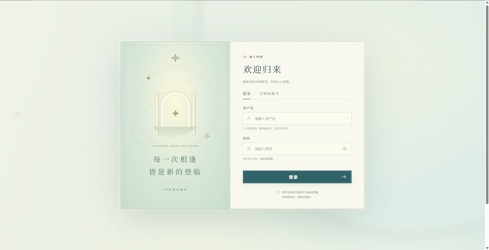

图1　账号登录：输入本地用户名和密码进入系统，也可切换至注册页创建账号。

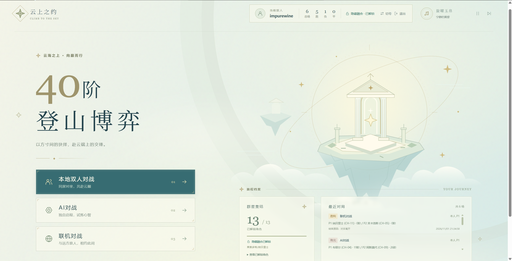

图2　项目首页：展示本地双人、AI和联机对战入口，以及账号战绩、已解锁角色和最近对局；顶部提供账号切换与音乐控制。

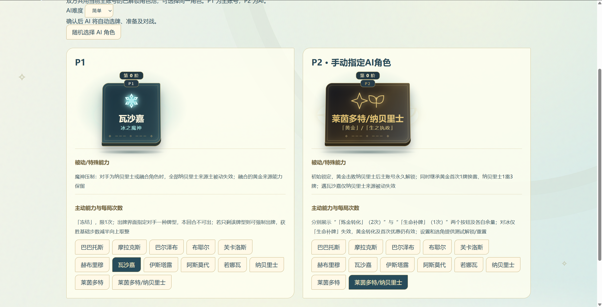

图3　角色选择：P1选择瓦沙嘉，P2手动指定融合角色；界面同时展示角色被动、主动能力及AI难度配置，便于开局前比较策略。

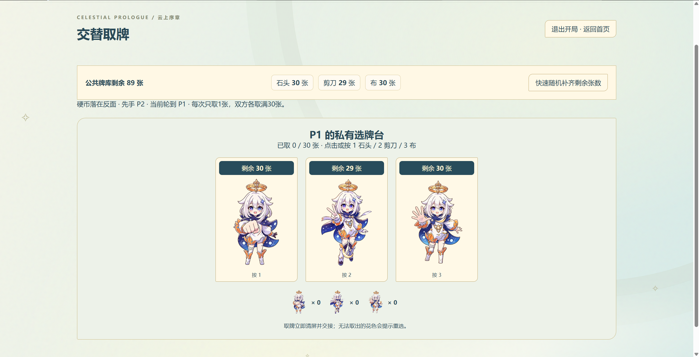

图4　交替取牌：公共区显示牌库总数和各花色余量，当前玩家通过图片或快捷键取牌；双方各取满30张后进入准备阶段。

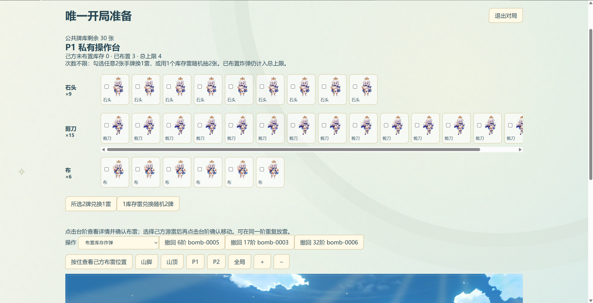

图5　唯一开局准备：按花色展示本人手牌，提供牌雷兑换、布雷、撤回和地图定位操作；截图中已布置3枚炸弹，位置为6、17和32阶。

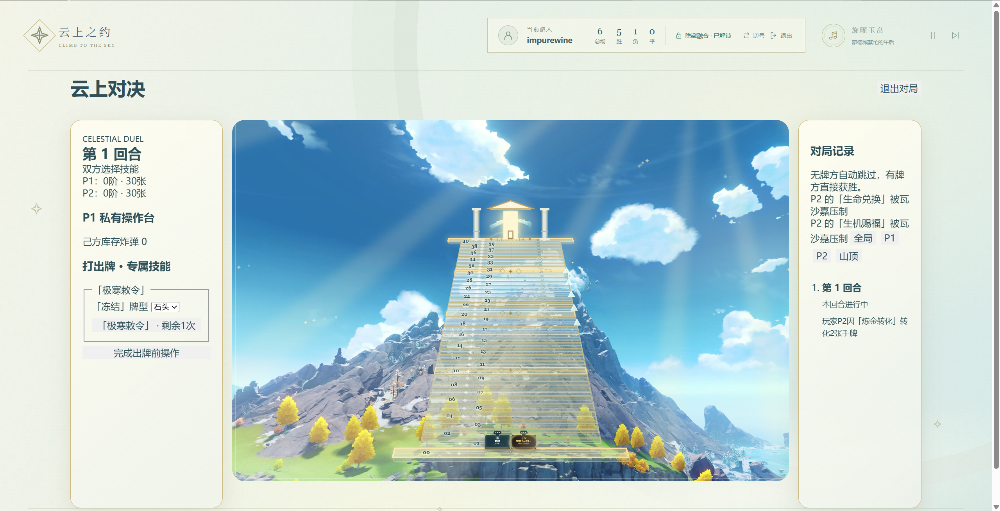

图6　回合对战：左侧为当前回合与角色专属技能，中间为0～40阶立体天梯，右侧记录技能压制和本回合事件；截图展示第1回合技能选择阶段。

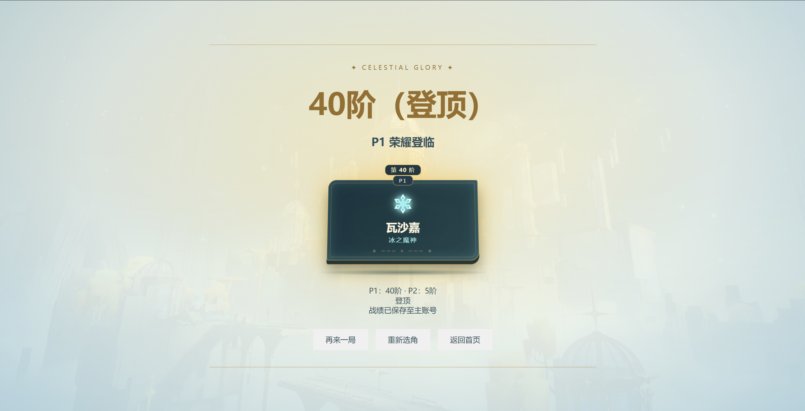

图7　登顶结算：P1到达40阶，P2位于5阶，页面显示胜利角色和战绩保存结果，并提供再来一局、重新选角和返回首页入口。

## 2 AI开发过程

### 2.1 需求分析：先确定规则与验收结果

本节简要说明需求形成过程与主要验收条件。完整材料与源文件位于GitHub仓库的[docs/01-requirements.md](https://github.com/impureWine/UML/blob/main/docs/01-requirements.md)、[docs/01-usecasediagram.puml](https://github.com/impureWine/UML/blob/main/docs/01-usecasediagram.puml)。

需求分析通过流程约定、初稿生成、规则裁决和角色扩展逐步确定实现范围。以下交互截图记录了需求形成过程，随后汇总确认后的主要需求与用例。

**第一步：约定开发流程，把游戏构想转化为阶段任务。**

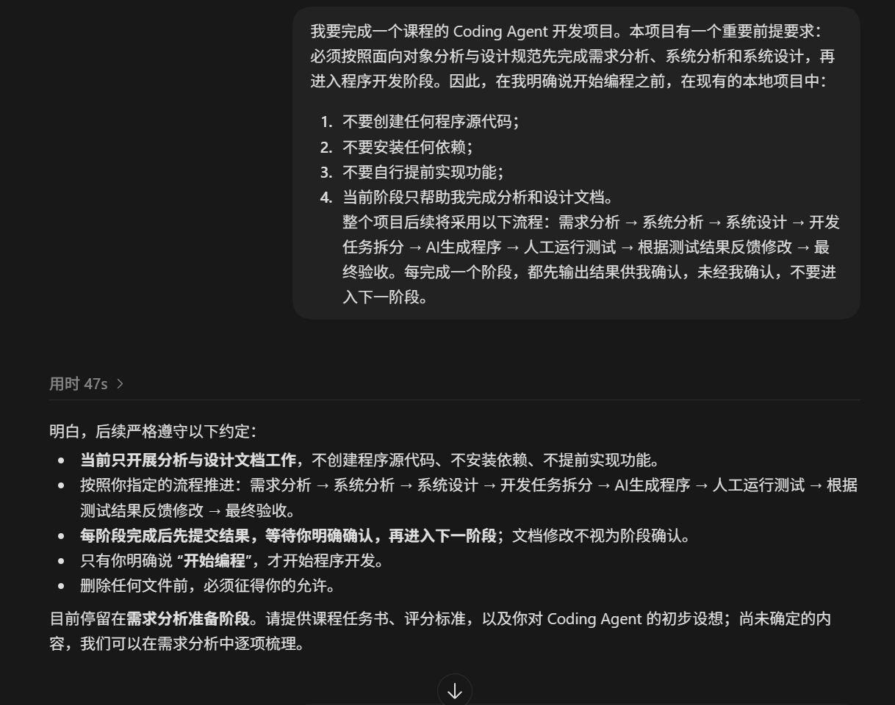

图8　开发流程约定：开发者提出先完成需求分析、系统分析与系统设计，再进入任务拆分、代码生成、人工测试和反馈修改；AI确认按阶段提交结果。

项目启动时，开发者首先向AI说明课程的开发要求，并将工作划分为需求分析、系统分析、系统设计、任务拆分、程序生成、人工测试、反馈修改和最终验收。提示词明确规定，分析与设计阶段先输出文档，完成一个阶段后提交审阅，经确认再推进。这样，最初的游戏构想就有了具体的实施顺序，也为每个阶段确定了可检查的产出。

截图中的AI答复逐项确认了这些约定，并将当时的状态定位为需求分析准备阶段。开发者负责提出玩法、裁决规则和判断实际体验，AI负责整理分析结果、维护文档并在后续生成实现。双方通过阶段确认衔接工作，使开发者能够在规则和结构尚易于调整时及时提出修改。

这次交互为后续开发确定了一条持续使用的方法：先描述任务与约束，再审阅AI产出，最后根据具体反馈推进下一步。例如，需求阶段审阅功能与规则，分析阶段检查对象关系，程序阶段运行界面和测试。每轮交流因此都能围绕明确的判断依据展开，逐步把创意转化为可验收的项目成果。

**第二步：形成需求初稿，将核心玩法放入完整产品场景。**

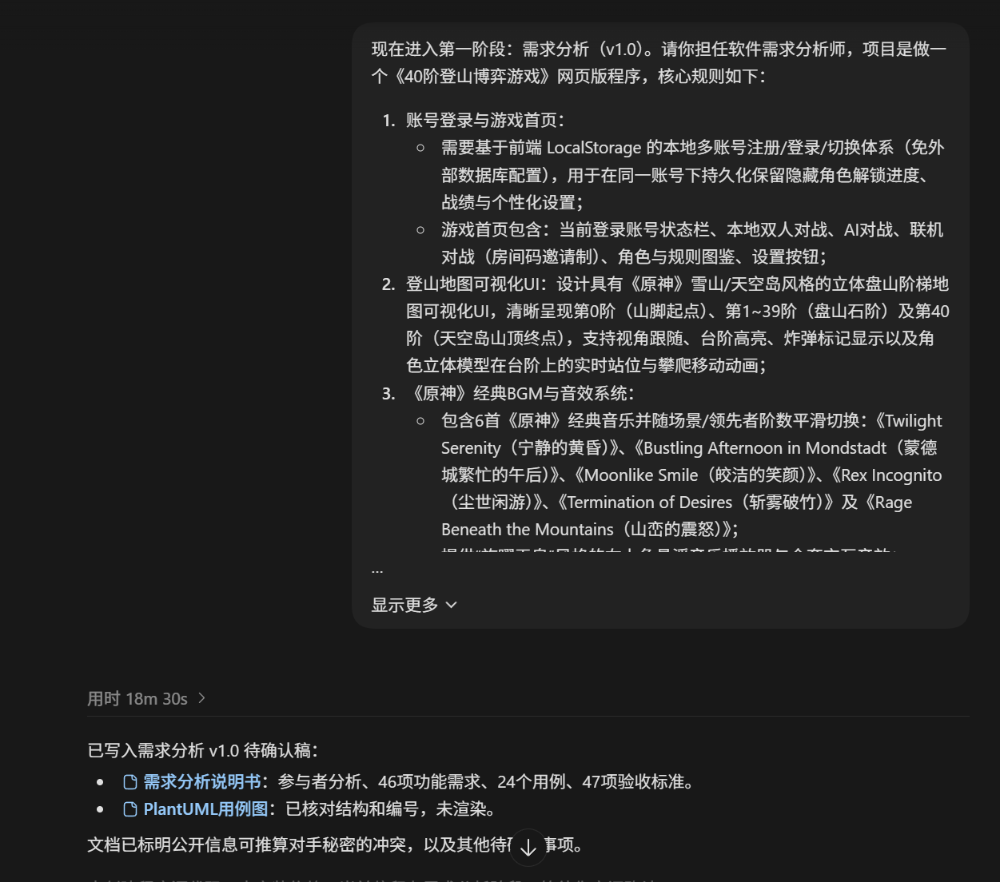

图9　需求分析v1.0：开发者说明本地多账号、首页入口、登山地图、音乐等要求；AI输出包含46项功能需求、24个用例和47项验收标准的初稿，并列出待确认事项。

在需求初稿阶段，开发者要求AI担任软件需求分析师，将游戏构想整理成网页版程序的需求。截图中列出了本地多账号、首页入口、地图可视化与音乐系统等内容：账号保存战绩、角色解锁和偏好，首页连接三种对战模式，地图呈现登山位置，音乐随场景变化。这些要求把核心玩法放进了完整的使用流程，使项目从一组博弈规则发展为具有入口、操作界面和结果保存能力的游戏系统。

AI据此生成需求分析v1.0和PlantUML用例图，初稿包含46项功能需求、24个用例与47项验收标准。功能需求回答系统应提供什么，用例描述参与者如何使用系统，验收标准则为后续测试提供判断依据。例如，账号切换需要核对档案隔离，地图需要核对阶位与位置，对局中的私有信息需要检查显示范围。

初稿同时提出了公开信息能否推算秘密等待确认事项，引导开发者进一步明确规则。此时的主要成果是把口头构想整理成可以逐条审阅的文档，并形成下一轮讨论的问题清单。截图中的盘山地图记录了早期设想；经过后续确认，地图最终统一为笔直的0～40阶立体天梯，体现了需求到设计之间的逐步收敛。

**第三步：裁决规则歧义，让需求成为实现依据。**

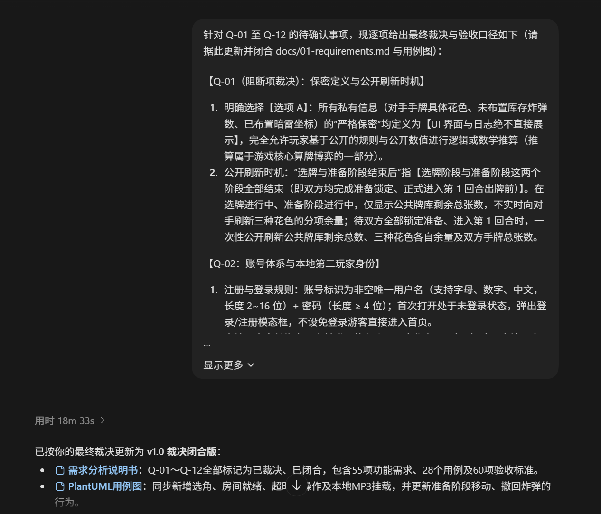

图10　Q-01至Q-12规则裁决：开发者明确私有信息的展示边界、公开信息刷新时机和账号身份等规则；AI更新需求与用例图，形成55项功能需求、28个用例和60项验收标准。

需求初稿完成后，开发者针对Q-01至Q-12逐项给出裁决，并要求AI同步更新需求文档与用例图。截图重点展示了信息保密的定义：对手手牌花色、库存炸弹与暗雷坐标受到展示限制，玩家仍可以依据公开规则和数值进行推理。这一约定与限定猜拳的算牌和心理博弈相联系，使“哪些数据由系统提供”和“哪些结论由玩家推算”有了清晰的区分。

开发者还明确了当时采用的公开刷新时机，以及账号名称、密码、首次登录和本地第二玩家身份等条件。AI据此形成裁决闭合版，将需求更新为55项功能、28个用例和60项验收标准。原先需要解释的概念被转化为可以执行的条件，后续界面、日志和对局控制可以依据同一套约定工作。

这一轮的作用，是建立由开发者作出规则决定、AI同步维护相关材料的协作方式。规则后续随体验反馈继续细化：例如，联机取牌期的各花色余量后来被确定为公共信息，并反映在实机取牌界面和信息投影中。因此，截图保留了当时的决策过程，当前程序则执行后续已明确的规则。

**第四步：补充角色技能，把角色差异转化为策略规则。**

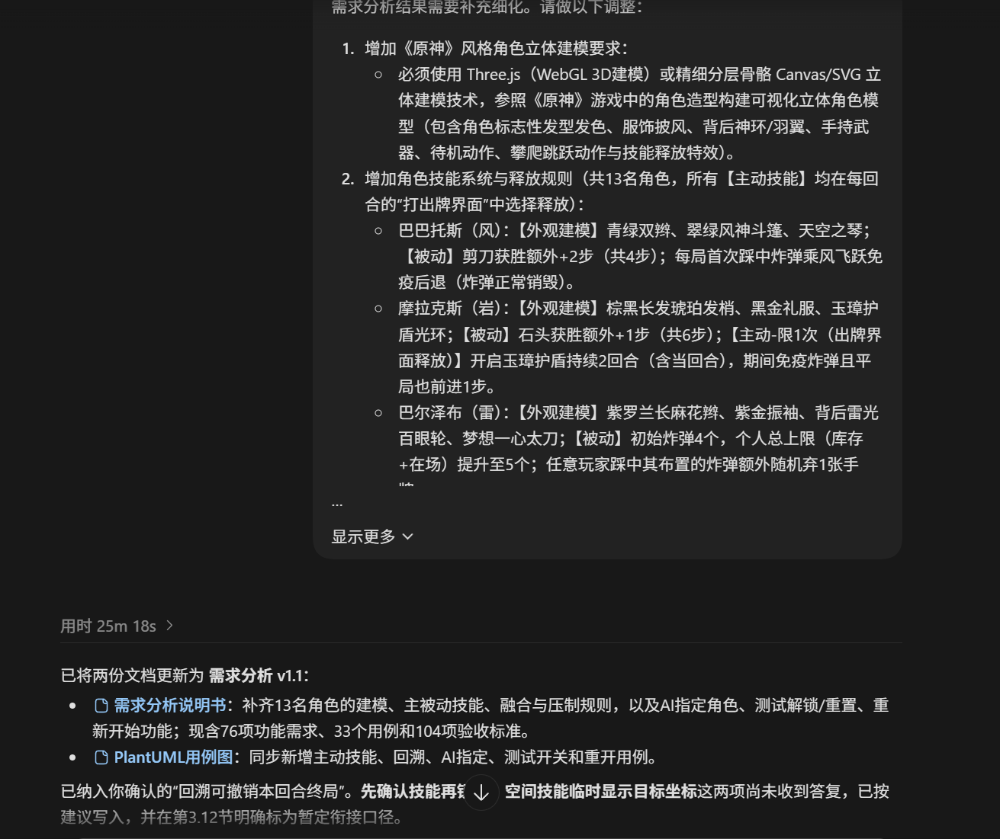

图11　需求分析v1.1：开发者补充13名角色的表现、主动与被动技能、融合和压制规则；AI将需求扩展为76项功能需求、33个用例和104项验收标准，并纳入回溯与AI指定角色等内容。

基础需求明确后，开发者进一步补充13名角色的外观表现、主动技能、被动能力和每局使用次数，并要求所有主动操作在回合出牌界面中选择。截图中的角色条目同时包含表现要求与规则效果，例如风角色通过特定牌型获得移动增益，岩角色通过护盾影响踩雷和推进，雷角色改变炸弹资源条件。角色因此直接参与手牌与地雷阵的决策，形成第三个核心玩法层。

AI将这些内容整理为需求分析v1.1，扩展至76项功能需求、33个用例和104项验收标准，并补充融合角色、来源压制、时间回溯、AI指定角色和重新开始等要求。复杂度由此从单一技能效果推进到技能之间的关系：融合角色需要保留不同来源，压制需要精确作用于相应能力，回溯则需要考虑牌、位置与次数的恢复。

这些规则为下一阶段的对象分析提出了明确问题：角色怎样组合技能，技能如何记录来源与剩余次数，哪些状态需要进入回合快照。后续Character、SkillComponent和RoundSnapshot的设计均围绕这些问题展开。角色的视觉呈现也继续结合开发反馈调整，当前实机以角色铭牌、元素标识和动画表现其身份及状态。

需求分析首先明确三类使用场景：同一设备由两人交接操作、单人对抗AI、两端通过房间码对战。三类模式共享玩法规则，但私有信息展示和操作等待方式不同。本地双人需要遮罩与交接；AI和联机需要固定本人视角，并在本人确认后提示等待对方。

| 需求类别 | 具体约定 | 验收关注点 |
| --- | --- | --- |
| 身份与存储 | 本地浏览器同源多账号，刷新后重新登录 | 切号不串档；失败不覆盖原档案 |
| 开局与资源 | 交替取牌、一次准备、实体牌编号和雷容量限制 | 不重复取牌；非法兑换不扣资源 |
| 回合公平性 | 先完成技能选择，再锁牌；齐锁后亮牌 | 一方先锁定不泄漏花色 |
| 信息隔离 | 允许查看本人资源及规则授权情报 | 页面和传输快照均不含对手秘密 |
| 角色规则 | 主动次数、被动效果、来源压制与回溯 | 失败不扣次数；回溯完整恢复 |
| 体验与反馈 | 阶位、等待、倒计时、技能和踩雷原因可见 | 操作不中断；结果能够解释 |

需求文档使用FR、BR、UC、AC等编号组织功能、业务规则、用例和验收条件。后续出现新裁决时，以最新明确要求更新相关模块。例如，联机选牌期的牌库花色余量后来被确定为公共信息；手牌组成和暗雷坐标继续保持私有。该修改同时进入服务端投影与本地回退通道，保证两种联机方式采用同一口径。

用例图从参与者与目标组织功能：未登录使用者完成注册与登录，账号使用者查看资料、选择模式或进入联机房间，对局玩家执行选角、准备、技能、出牌及结果查看。

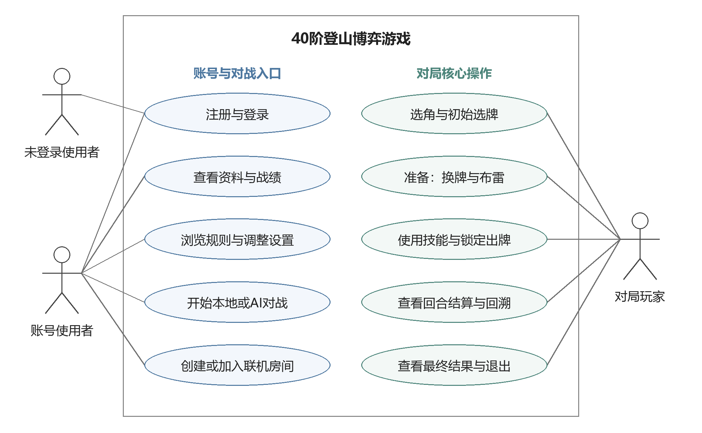

图12　系统用例图：系统边界内按“账号与对战入口”和“对局核心操作”归纳主要用例，连线表示参与者与用例的关联。

### 2.2 系统分析：识别主要对象及职责

本节简要说明核心对象、职责和关系。完整材料与源文件位于GitHub仓库的[docs/02-analysis.md](https://github.com/impureWine/UML/blob/main/docs/02-analysis.md)、[docs/02-classdiagram.puml](https://github.com/impureWine/UML/blob/main/docs/02-classdiagram.puml)。

需求确认后，系统分析先识别核心对象，再通过人工审阅明确资源边界和技能规则。下列交互展示对象职责与关系如何形成。

**第五步：开展系统分析，从功能描述中识别协作对象。**

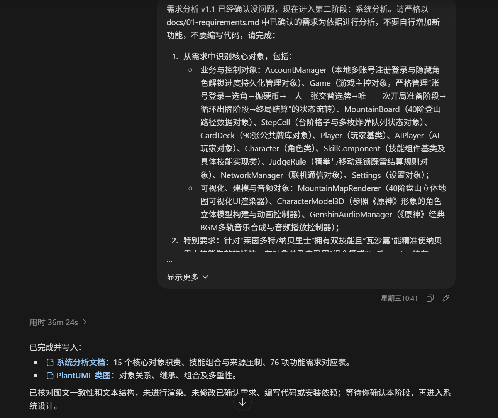

图13　系统分析：需求确认后，开发者要求识别账号、对局、棋盘、牌库、玩家、角色、技能、规则与联机等对象；AI输出15个核心对象的职责、技能组合与来源压制分析，以及PlantUML类图。

进入系统分析阶段时，开发者要求AI严格依据已经确认的需求识别核心对象，并说明各对象的职责及关系。提示词既列出账号、对局、玩家、牌库、棋盘与规则等业务对象，也提出地图、角色表现和音频控制等可视化对象。AI据此输出15个核心对象的职责分析、需求对应表和PlantUML类图，将功能描述推进为对象之间的协作结构。

这一结构与三个核心玩法一一关联。CardDeck和Player描述有限牌库、持有手牌与玩家资源，为限定猜拳提供数据基础；MountainBoard、StepCell和Bomb表示雷位与落点，为地雷阵结算提供结构；Character与SkillComponent组合角色能力，使移动、兑换、压制和回溯可以按规则协同工作。Game则负责组织选角、取牌、准备与回合阶段，将这些对象连接成完整对局。

分析还需要考虑对象关系的精度。融合角色同时拥有不同来源的能力，压制应影响对应来源的组件，因此技能来源和压制状态需要在分析中明确。通过这一步，开发者可以在编程前审阅各类职责是否清楚、关系是否符合玩法，以及每项需求是否有对象承接，再据此进入模块与接口设计。

**第六步：人工审阅分析结果，补齐边界条件。**

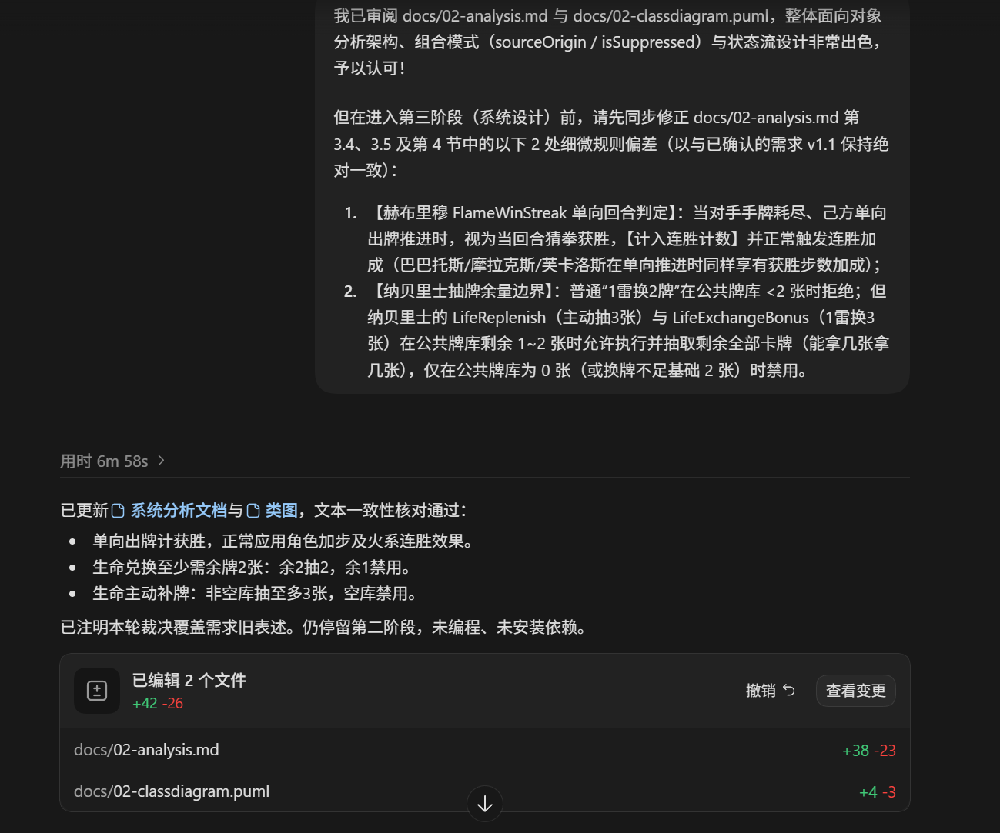

图14　分析结果审阅：开发者核对类图与系统分析，进一步明确单向出牌的获胜和连胜判定，以及生命技能在牌库不足时的处理；AI同步修订分析文档与类图。

系统分析产出后，开发者审阅了分析文档与类图，并针对两个会影响实际结算的边界提出修改。第一个问题是单向出牌：当对手手牌耗尽、己方仍能出牌时，这次推进是否计为获胜，是否触发角色移动加成与火角色连胜。明确这一点，才能使资源耗尽后的流程与正常回合使用一致的胜负口径。

第二个问题涉及生命能力在牌库不足时的处理。截图中开发者继续细化抽牌与兑换条件，AI答复将结果落实为生命兑换“至少余2张，余2抽2、余1禁用”，主动补牌“非空时抽至多3张，空库禁用”。这两个操作分别具有自己的执行门槛和数量限制，后续实现据此判断合法性与实际获得牌数。

AI随后同步修改系统分析文档与类图，并标注本轮裁决与旧表述的关系。这次交互体现了人工审阅的具体作用：开发者选择会改变游戏结果的操作场景，AI将规则修订落实到相关材料。其产出进一步成为程序中的条件检查与回归测试依据，例如单向推进的加成判定、牌库余量边界以及非法操作的资源保护。

系统把“玩家有什么”“当前处于什么阶段”“规则如何计算”“界面允许看到什么”分别交给对应对象处理。

| 对象 | 主要职责 | 协作关系 |
| --- | --- | --- |
| Game | 管理账号门禁、页面导航、对局阶段和操作提交 | 调用规则、模型、AI及网络服务，通知视图 |
| Player / AIPlayer | 保存席位、阶位、手牌和角色；AIPlayer扩展决策能力 | 关联Character，持有PlayingCard |
| CardDeck / CardLedger | 管理实体牌抽取、流转及账本一致性 | 为玩家资源变化与回溯提供依据 |
| MountainBoard / StepCell / Bomb | 表示41个阶位及各阶炸弹 | JudgeRule计算落点与连锁效果 |
| Character / SkillComponent | 组合角色技能、次数和压制状态 | Game按阶段检查并执行技能 |
| RoundSnapshot | 保存回合可恢复状态 | 支持TimeRewind撤销本次尝试 |
| InformationProjector | 生成面向席位和用途的受限快照 | 向界面、AI和网络提供授权信息 |
| AccountManager | 注册认证与账号事务 | 通过本地存储保存AccountProfile |

面向对象设计体现在三个方面。第一，通过封装让牌库、棋盘和账号各自维护数据约束。第二，AIPlayer继承Player，沿用同一玩家结构。第三，角色通过技能组件组合能力；融合角色保留黄金与生命来源，使压制可以作用于特定来源，而不必把整个角色作为单一开关处理。

核心类之间的关系如下图所示。Game组织两名玩家、公共牌库和棋盘，Player关联角色与手牌，Character组合技能组件，棋盘管理场上炸弹；账号管理和联机管理分别承担持久化与通信职责。图中采用中文概括主要属性和操作。

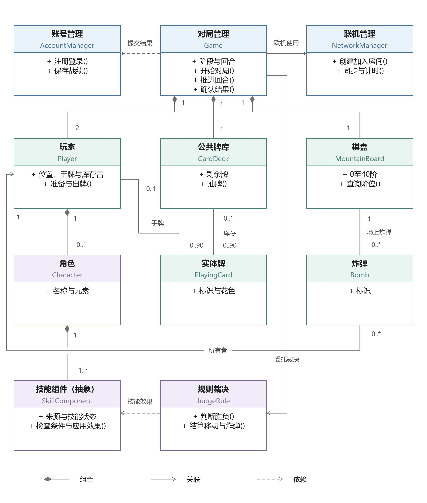

图15　核心类图：展示对局管理、玩家、牌库、棋盘、角色、技能组件及规则裁决的主要关联；实心菱形表示组合，箭头表示关联，虚线箭头表示依赖。

### 2.3 系统设计：模块划分与状态驱动

本节简要说明模块划分、状态流转与接口协作。完整材料与源文件位于GitHub仓库的[docs/03-design.md](https://github.com/impureWine/UML/blob/main/docs/03-design.md)、[docs/11-network.puml](https://github.com/impureWine/UML/blob/main/docs/11-network.puml)、[src/](https://github.com/impureWine/UML/tree/main/src)。

系统设计把已经确认的对象关系落实为模块划分、类接口与状态流转，并据此组织可独立验证的开发任务。

**第七步：完成系统设计，将对象关系落实为模块和接口。**

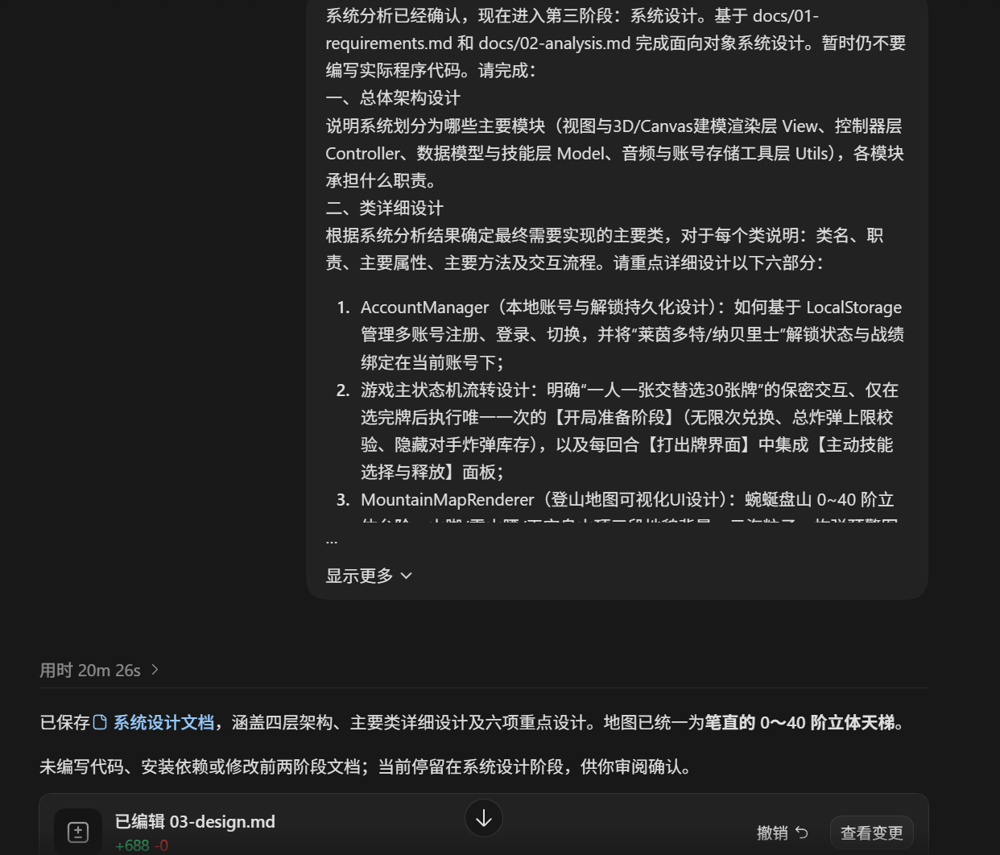

图16　系统设计：开发者要求明确View、Controller、Model及工具层职责，并详细设计账号存储、主状态机、地图和技能交互；AI写入系统设计文档，地图统一为笔直的0～40阶立体天梯。

系统分析确认后，开发者要求AI以需求和分析文档为依据完成系统设计，重点说明总体架构、各模块职责、主要类的属性与方法，以及关键交互流程。截图中进一步点明账号持久化、主状态机、唯一开局准备和主动技能面板等设计任务，使设计能够回应实际操作路径。AI随后写入系统设计文档，形成四层架构、主要类设计和六项重点设计内容。

各层通过明确的数据与命令协作。模型保存手牌、棋盘和技能状态，控制器校验当前阶段并推进规则，视图展示本人可见的信息和操作入口，工具层处理账号存储、通信与音频。以准备阶段为例，界面提交兑换或布雷请求，控制器检查资源、容量和阶段条件，模型完成更新，再由界面展示结果。这样的设计为后续定位错误提供了具体位置。

这一阶段还确认地图采用笔直的0～40阶立体天梯，把前期视觉设想收敛为具体布局。设计完成后，AI生成代码所依据的材料包括功能条件、对象关系、模块职责和操作流程。项目由此具备进入程序开发的结构基础，后续每轮实现可以围绕相应模块生成文件，并验证其是否符合已经确认的设计。

前端采用JavaScript模块组织，Vite负责开发与构建，Three.js负责立体地图。源码按model、controller、view、utils和audio划分；Node.js服务端使用Express提供静态资源，使用ws承载房间消息。账号档案存于浏览器LocalStorage，服务端维护运行中的房间。

核心调用关系为：用户界面提交命令 → Game校验阶段和席位 → 模型及规则更新状态 → InformationProjector生成授权快照 → 界面更新地图、手牌与记录。联机模式由服务端执行权威规则，客户端只接收本席可见的数据。

对局阶段依次包括CHARACTER_SELECT、COIN、COIN_ANIMATION、DRAFT、PREPARATION、ROUND_SKILLS、CARD_LOCK、RESOLVE、ROUND_REVIEW和FINAL。每个阶段限定可执行动作；双方各自确认后才进入下一阶段。回溯以attemptNo区分同一回合的不同尝试，旧操作令牌不能跨阶段或跨尝试复用。

地图与战斗面板使用投影数据，避免直接遍历完整对局。规则计算与动画展示也分别处理：规则确定实际落点和事件，视图据此播放移动、爆炸和亮牌。这样既能单独测试结算，也能在界面重绘时保留业务状态。

图12和图15采用开发者提供的用例图与核心类图。项目同时保留01-usecasediagram.puml、02-classdiagram.puml和11-network.puml作为需求与设计阶段的详细材料；本报告的模块说明以当前代码为依据。

**第八步：拆分开发迭代，使设计逐步成为可运行成果。**

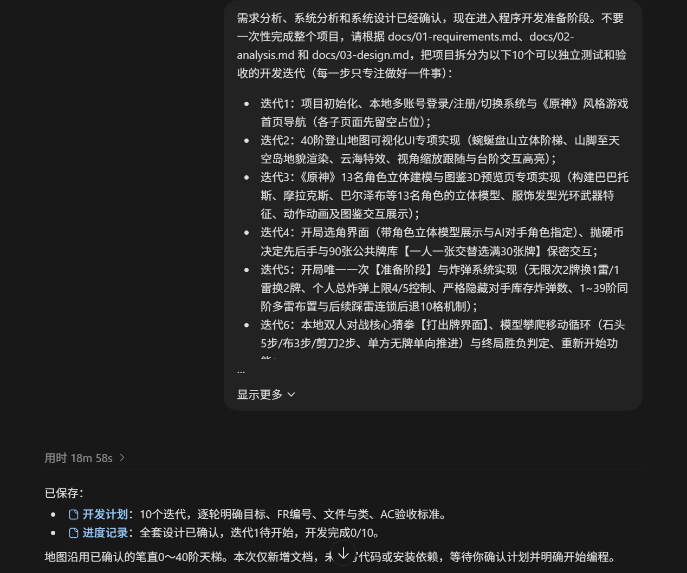

图17　开发准备：前三阶段确认后，开发者要求将项目拆为10个可独立测试和验收的迭代；AI保存逐轮目标、需求编号、文件与类、验收标准和进度记录。

完成前三阶段确认后，开发者要求AI把项目拆成10个能够独立运行、测试和验收的迭代，每轮集中解决一组明确问题。AI据此保存开发计划与进度记录，为各轮列出目标、关联需求编号、涉及文件和类，以及验收标准。设计材料由此进一步转化为可以按顺序执行的开发任务，开发者也能够逐轮观察实际成果并提出调整。

迭代顺序考虑了功能之间的依赖：账号首页提供入口和档案基础，地图与角色建立表现层，开局选牌和准备形成资源状态，基础对战打通完整循环，随后补充技能、音乐、AI和联机。每增加一组能力，既检查本轮行为，也回归已有流程。例如，加入技能后需要重新核对移动、踩雷和终局，加入联机后需要核对席位权限、信息隔离和界面同步。

截图记录的是编程前的计划，后续分轮交付表、测试输出和反馈记录展示了计划如何落实。图1至图7对应从登录、选角、取牌、准备到登顶的可运行界面，构成设计任务与实际成果之间的联系。项目后续又增加第11轮权威WebSocket服务端，使既有玩法通过服务端维护房间与对局，继续扩展联机通信能力。

### 2.4 分轮生成与交付

本节简要说明各轮任务与阶段产出。完整材料与源文件位于GitHub仓库的[docs/04-plan.md](https://github.com/impureWine/UML/blob/main/docs/04-plan.md)、[docs/PROGRESS.md](https://github.com/impureWine/UML/blob/main/docs/PROGRESS.md)。

逐轮实现、修改文件和验收清单位于[docs/05-process1.md](https://github.com/impureWine/UML/blob/main/docs/05-process1.md)、[docs/05-process2.md](https://github.com/impureWine/UML/blob/main/docs/05-process2.md)、[docs/05-process3.md](https://github.com/impureWine/UML/blob/main/docs/05-process3.md)、[docs/05-process4.md](https://github.com/impureWine/UML/blob/main/docs/05-process4.md)、[docs/05-process5.md](https://github.com/impureWine/UML/blob/main/docs/05-process5.md)、[docs/05-process6.md](https://github.com/impureWine/UML/blob/main/docs/05-process6.md)、[docs/05-process7.md](https://github.com/impureWine/UML/blob/main/docs/05-process7.md)、[docs/05-process9.md](https://github.com/impureWine/UML/blob/main/docs/05-process9.md)、[docs/05-process10.md](https://github.com/impureWine/UML/blob/main/docs/05-process10.md)、[docs/05-process11.md](https://github.com/impureWine/UML/blob/main/docs/05-process11.md)。

| 轮次 | AI主要生成内容 | 阶段产出及验证重点 |
| --- | --- | --- |
| 1 | 项目骨架、账号和首页 | 注册登录、隔离存储、导航；29项测试 |
| 2 | 立体天梯与镜头 | 41阶、缩放选阶、背景与资源生命周期；40项测试，后续背景增量43项 |
| 3 | 角色目录与铭牌 | 13角色、元素SVG、动画和图鉴；图标修正后46项测试 |
| 4 | 选角、硬币和取牌 | 实体牌、交替操作、私密交接、准备到达视图 |
| 5 | 唯一准备阶段 | 兑换、布雷、容量限制和确认 |
| 6 | 完整基础对战 | 同时亮牌、移动、踩雷、终局及战绩 |
| 7～8 | 角色技能与融合能力 | 专属面板、技能次数、来源压制、回溯和解锁；迭代9记录确认此前1～8已验收 |
| 9 | 音乐与音效 | 六曲目录、原录音、合成回退、播放器和账号音量 |
| 10 | AI、同源房间与设置 | 合法AI决策、房间同步、并行操作与界面反馈修正 |
| 11及增量 | 权威WebSocket服务端 | 跨设备通道、席位投影、超时、媒体加载和重绘稳定性 |

每轮交付均将实现文件、检查结果和人工验收步骤写入过程记录。现有过程文件由05-process1.md延续至05-process11.md；第8轮成果由后续记录和当前源码共同佐证，目录中没有单独的05-process8.md。

### 2.5 代表性AI交互

本节选取真实交互截图概述开发与修改过程，截图下方按主题列出对应的完整过程记录和实现文件；这些链接用于查看相关产出。

以下实例采用开发者提供的14张真实交互截图，按地图、开局、技能、音乐和联机五组展开。各组同时呈现首次实现与后续反馈，说明任务如何从具体要求推进为代码、阶段检查和体验修改。截图中的测试数量对应当时的版本，当前工作区的验证结果见第3.3节。

**实例一：地图搭建与视觉迭代**

本组案例简述任务与反馈；完整过程和对应代码：[docs/05-process2.md](https://github.com/impureWine/UML/blob/main/docs/05-process2.md)、[src/view/MountainMapRenderer.js](https://github.com/impureWine/UML/blob/main/src/view/MountainMapRenderer.js)、[src/view/BackgroundTransition.js](https://github.com/impureWine/UML/blob/main/src/view/BackgroundTransition.js)。

**立体天梯地图专项实现。**

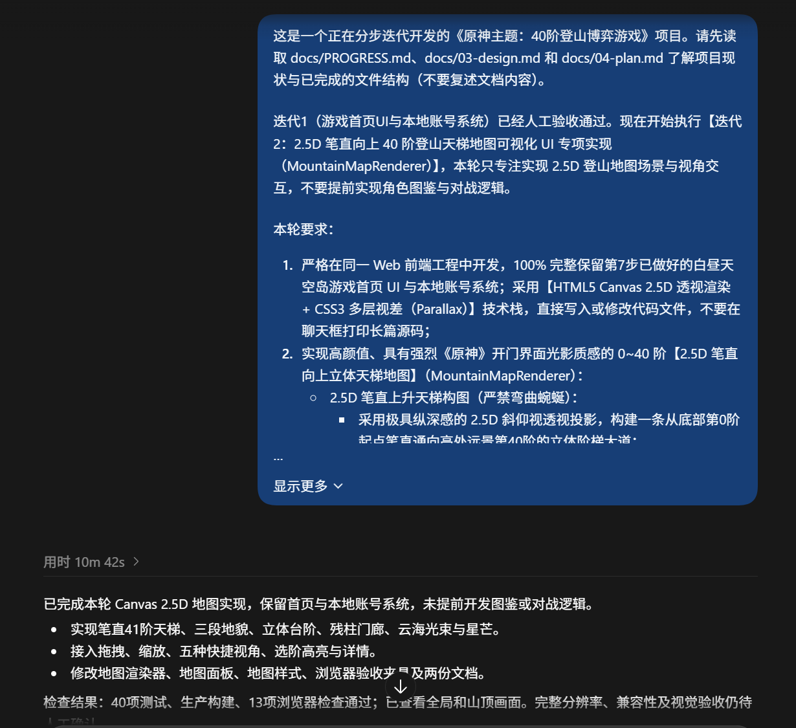

图18　地图专项开发：开发者限定本轮实现0～40阶地图和视角交互，AI交付41阶天梯、分段地貌、快捷视角及选阶详情，并报告阶段检查结果。

这一实例展示了如何用明确范围组织一次AI开发任务。开发者先要求AI读取项目进度、设计和计划，了解已有首页与本地账号系统，再将本轮目标限定为地图可视化和视角交互。提示词还明确天梯应笔直向上，并保留前一轮成果，使地图能够作为既有工程中的新模块逐步接入。

AI答复列出了41阶天梯、三段地貌、门廊、云海、拖拽缩放和快捷视角等产出，并报告当时40项测试、构建与13项浏览器检查通过。截图记录的是该次Canvas 2.5D实现，后续工程中的地图实现继续演进。此轮先建立可操作的场景，再由后续迭代接入角色和对战状态，体现了从独立模块到完整流程的推进方式。

**按玩家阶位切换背景。**

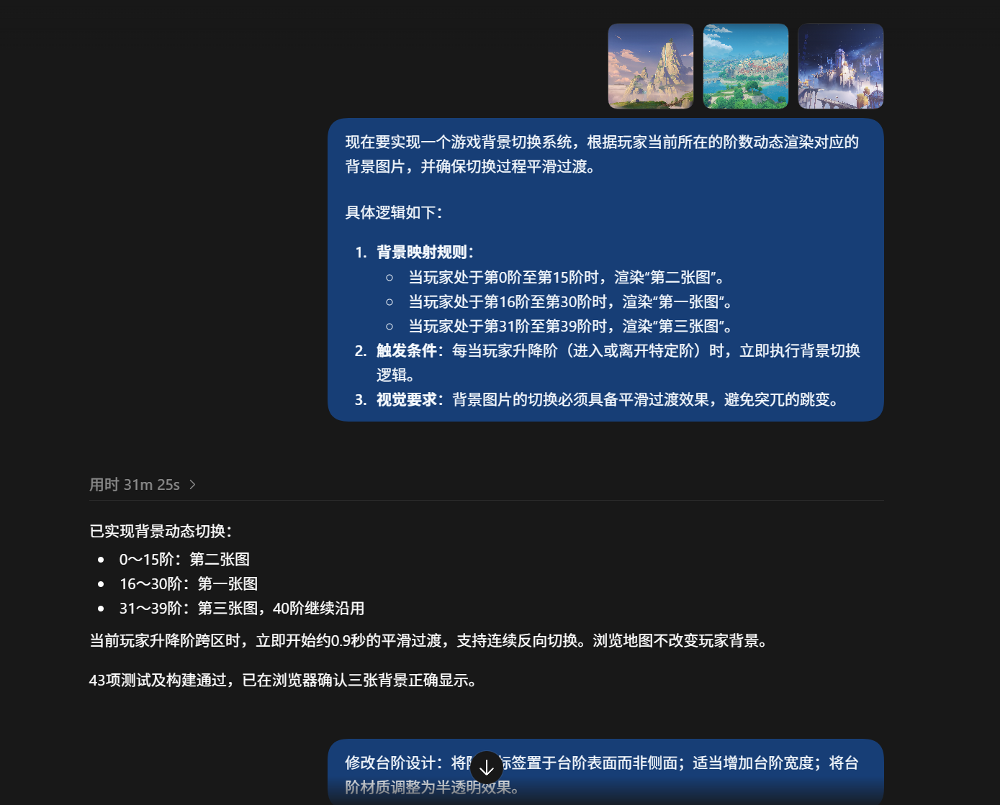

图19　背景动态切换：开发者给出三张图片与阶数映射，AI实现约0.9秒的平滑过渡，并说明升降阶与连续切换的处理。

地图具备基本结构后，开发者提供三张背景图片，并用阶数区间定义它们的使用条件：0～15阶使用第二张，16～30阶使用第一张，31～39阶使用第三张。提示词同时要求升降阶立即触发逻辑，切换过程平滑。这使“背景随登山变化”的视觉目标转化为资源、区间、触发条件和过渡效果四项可执行要求。

AI按该映射实现动态切换，将40阶延续为高区背景，并报告约0.9秒的过渡、连续反向切换支持及43项测试和构建通过。答复还区分玩家位置变化与浏览地图，说明仅浏览其他阶位不会改变玩家所属背景。该实例把地图从静态展示推进到随游戏状态变化的场景反馈。

**台阶可读性与雪山背景修改。**

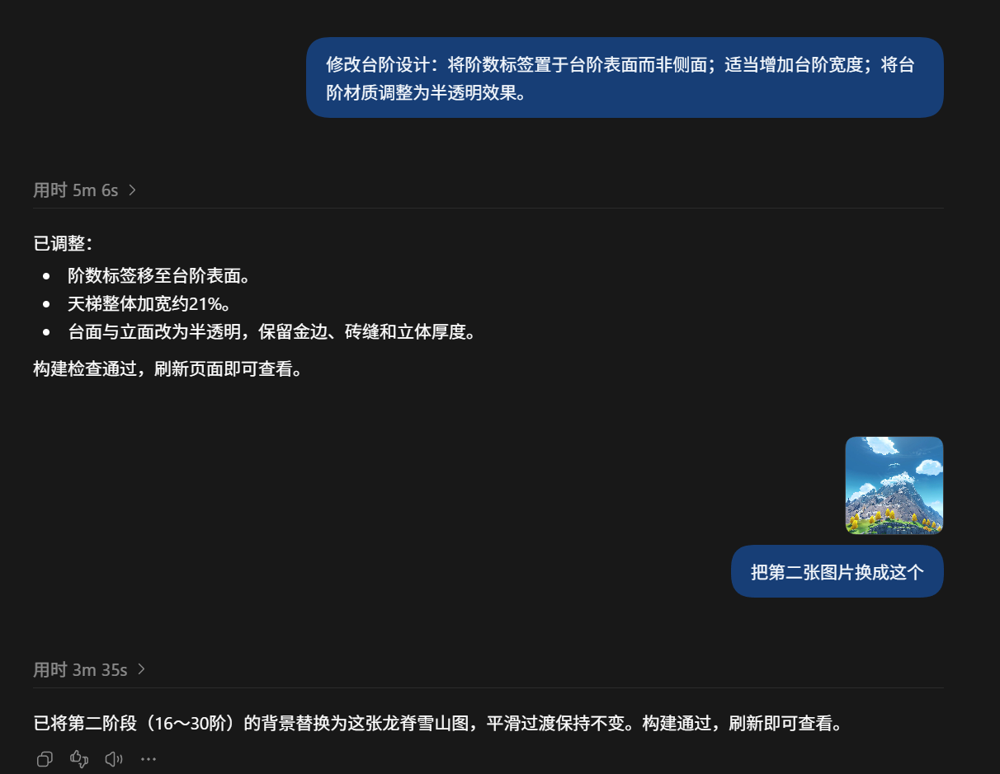

图20　地图视觉反馈：阶数标签移至台面，天梯加宽约21%，材质改为半透明；随后将16～30阶背景替换为指定雪山图片。

初步查看地图后，开发者进一步提出三个具体修改：阶数标签放在台面，台阶适当加宽，材质采用半透明效果。与抽象的美化要求相比，这些反馈直接对应文字位置、几何尺寸和材质表现，AI能够据此调整渲染参数，并保留金边、砖缝与立体厚度等视觉细节。

同一截图还记录了下一次资源替换：开发者提供新的龙脊雪山图片，要求替换第二阶段背景。AI将其应用到16～30阶，并保持既有平滑切换逻辑。两次交互展示了视觉迭代的连续性：先改善阶号辨认和地图通透感，再调整场景素材，使布局、交互和主题表现逐步协调。

**实例二：开局流程与选牌交互**

本组案例简述任务与反馈；完整过程和对应代码：[docs/05-process4.md](https://github.com/impureWine/UML/blob/main/docs/05-process4.md)、[src/view/OpeningPanel.js](https://github.com/impureWine/UML/blob/main/src/view/OpeningPanel.js)、[src/model/CardDeck.js](https://github.com/impureWine/UML/blob/main/src/model/CardDeck.js)。

**选角、抛币与交替取牌实现。**

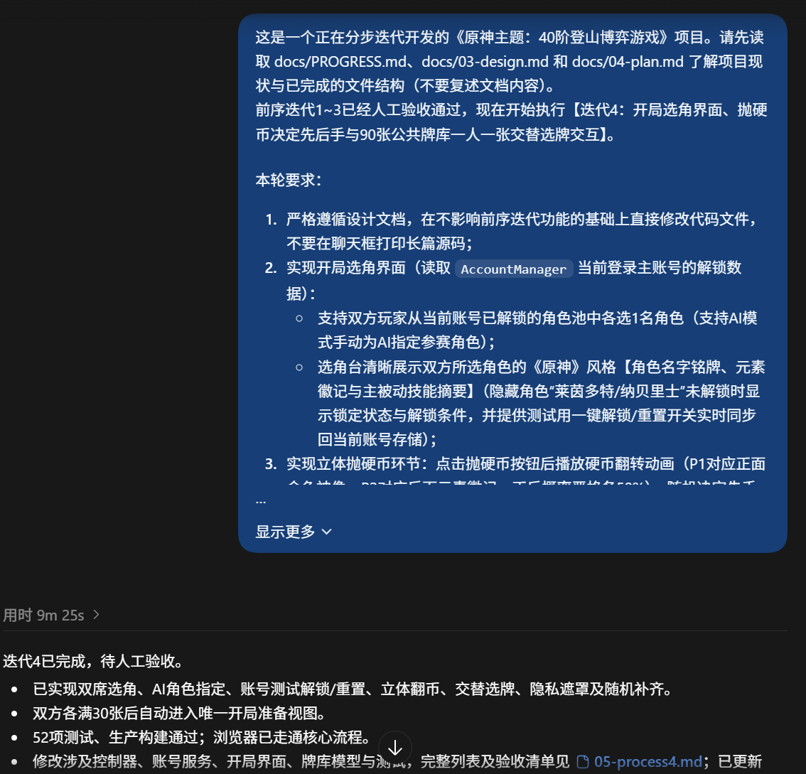

图21　开局流程实现：AI依据已确认的前三轮成果，新增双席选角、AI角色指定、抛币、交替选牌、私密遮罩和随机补齐，并报告52项测试通过。

这一任务把已有账号、角色与地图连接为正式开局流程。开发者要求AI先读取当前工程资料，再从主账号解锁池中为双方选择角色，并展示名字铭牌、元素和技能摘要。选角之后通过抛币确定先手，再从90张公共牌中交替取牌，使各个独立模块开始围绕一局游戏协同工作。

AI交付了选角、AI角色指定、立体翻币、交替取牌、私密交接与随机补齐，双方各取满30张后进入准备到达视图。截图中的账号测试解锁和重置是该阶段的调试安排，后续又按反馈调整。答复报告52项测试和生产构建通过，并将本轮结果标为待人工验收，使代码产出与阶段确认相衔接。

**图片牌面、公开余量与硬币选面。**

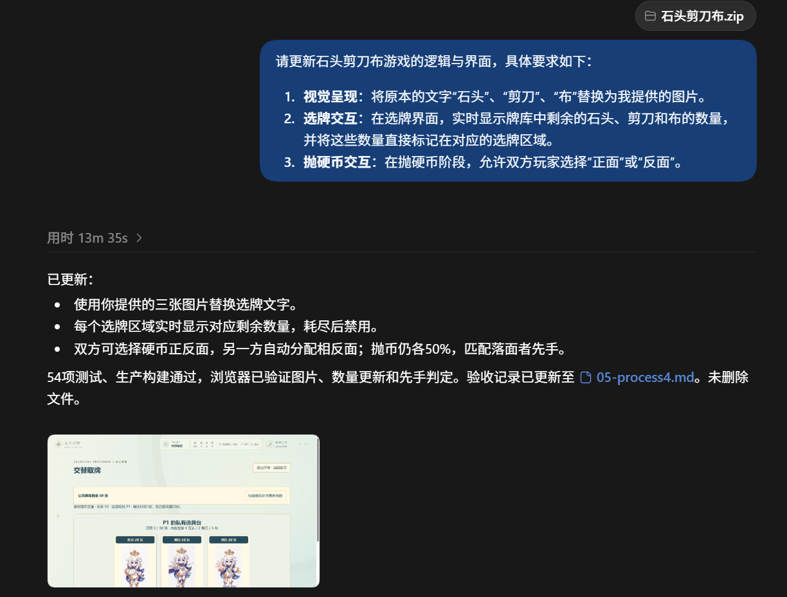

图22　开局交互完善：使用提供的石头剪刀布图片，实时展示各花色余量并在耗尽后禁用；双方选定硬币对应面，落面仍保持50%随机。

开局流程运行后，开发者提供石头、剪刀、布图片资源，要求替换原有文字牌面，同时将各花色剩余数量直接显示在选牌区域。由此，有限牌库这一玩法机制获得了直观表现：玩家既能辨认可选牌型，也能根据实时余量考虑资源竞争，耗尽的花色则不能继续取用。

开发者还补充了抛币前选择正反面的操作。AI将一方选择映射为双方对应面，并保持硬币落面的随机性，以落面匹配确定先手。答复记录54项测试、构建和浏览器检查通过，并附取牌界面截图。这一轮将功能入口继续细化为玩家可以理解和主动参与的交互。

**实例三：角色技能与回合反馈**

本组案例简述任务与反馈；完整过程和对应代码：[docs/05-process7.md](https://github.com/impureWine/UML/blob/main/docs/05-process7.md)、[src/model/SkillComponent.js](https://github.com/impureWine/UML/blob/main/src/model/SkillComponent.js)、[src/view/CharacterSkillDetails.js](https://github.com/impureWine/UML/blob/main/src/view/CharacterSkillDetails.js)、[src/view/BattlePanel.js](https://github.com/impureWine/UML/blob/main/src/view/BattlePanel.js)。

**11名基础角色技能实现。**

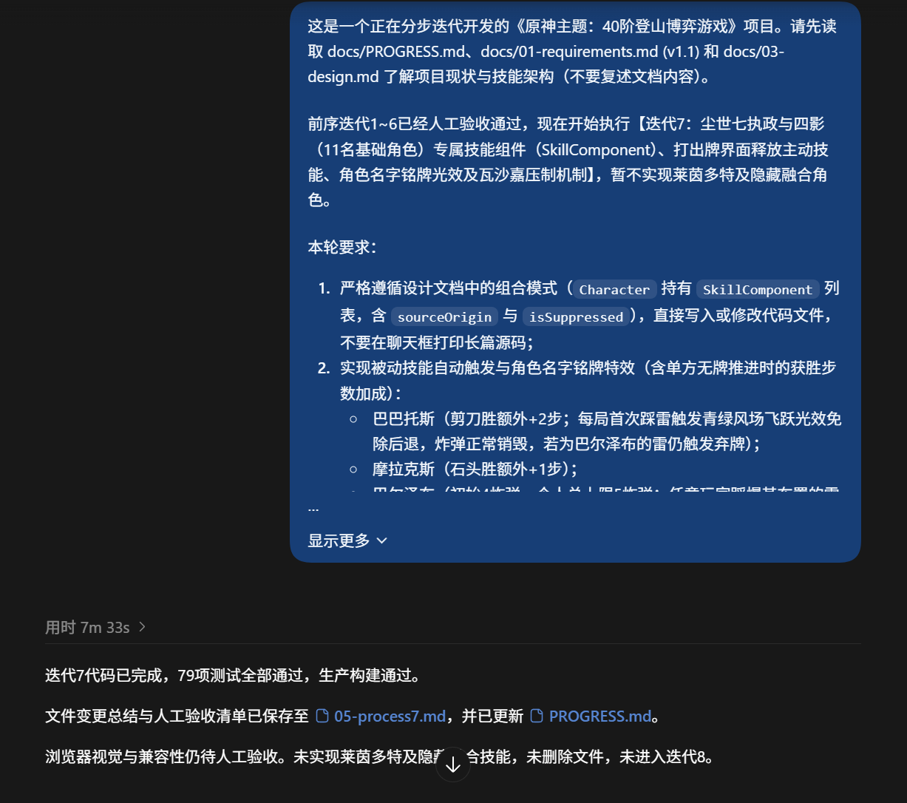

图23　角色技能专项：开发者要求使用Character组合SkillComponent，保留来源和压制状态；AI完成本轮技能代码，报告79项测试通过。

基础对战打通后，开发者将第7轮任务限定为11名基础角色的专属技能，并要求沿用Character持有SkillComponent列表的组合模式。技能组件包含sourceOrigin和isSuppressed等状态，用来表示能力来自何处、是否受到压制。提示词还强调单向出牌的移动加成，使此前分析阶段确认的边界进入实际实现。

AI答复报告技能代码完成、79项测试和生产构建通过，并将修改清单与人工验收步骤写入过程文档。黄金与融合角色留在后续轮次单独实现。这一任务使角色差异从需求表中的文字转化为参与结算的能力，也为后续融合角色复用不同来源组件建立基础。

**角色专属面板与交互反馈。**

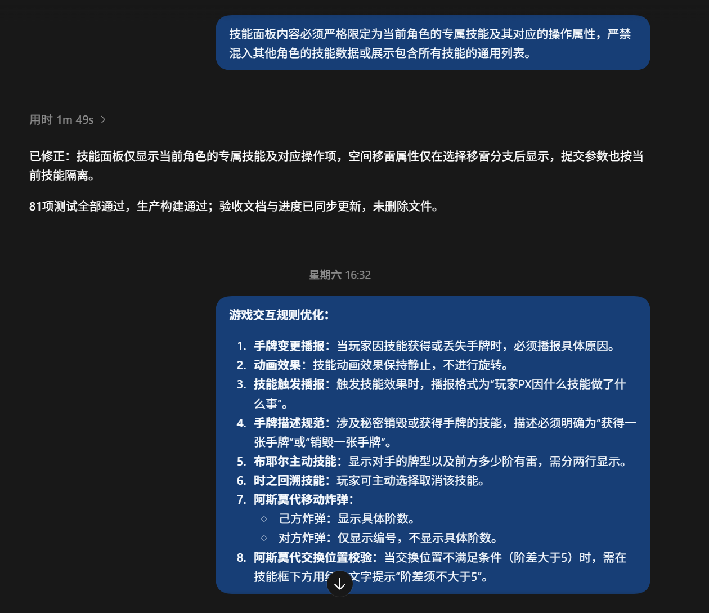

图24　技能面板反馈：限定显示当前角色的技能与参数，修正后报告81项测试通过；开发者继续提出原因播报、回溯取消和秘密信息显示等要求。

技能接入后，开发者检查操作界面，要求面板只展示当前角色的专属技能及相关参数。AI据此将空间移雷等属性按分支显示，并从当前技能区域读取提交参数，避免通用表单混入其他角色字段。截图中答复记录了81项测试与构建通过，说明修订已经落实为面板生成和参数隔离。

接着，开发者列出八项交互优化，包括手牌变化说明具体原因、技能效果采用明确播报、侦察分行展示、允许取消回溯，以及己雷显示阶数、敌雷只显示编号。反馈覆盖操作清晰度与信息权限两方面，使AI继续处理“能力能够执行”之外的“玩家能否理解并正确使用”。

**技能播报归入回合记录。**

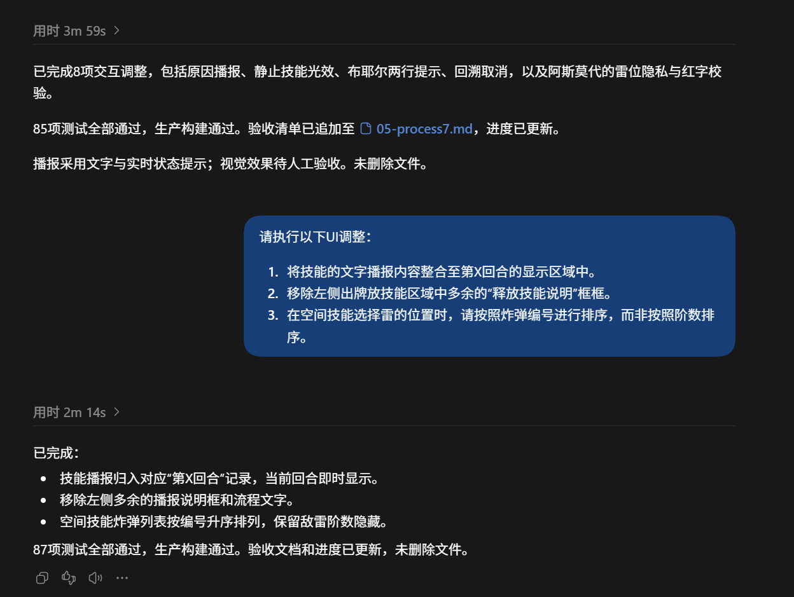

图25　技能反馈整理：AI完成八项调整后，开发者要求将播报归入对应回合、精简左侧说明并按炸弹编号排序；后续答复报告87项测试通过。

这张截图承接上一轮八项反馈。AI先报告完成原因播报、静止光效、侦察两行提示、回溯取消及雷位隐私等修改，阶段测试增至85项。开发者再从信息布局提出要求：技能播报应进入对应第X回合记录，左侧操作区精简说明，空间技能候选按炸弹编号排序。

AI随后将当前回合播报实时归入回合记录，整理操作区，并保留敌方雷位隐藏，报告87项测试与构建通过。这一过程使界面形成稳定分工：左侧负责执行操作，右侧负责解释回合事件；候选编号顺序则方便重复寻找目标。两轮反馈共同展示了规则实现后继续改善可读性和操作效率的过程。

**实例四：音乐系统与播放器修正**

本组案例简述任务与反馈；完整过程和对应代码：[docs/05-process9.md](https://github.com/impureWine/UML/blob/main/docs/05-process9.md)、[src/audio/GenshinAudioManager.js](https://github.com/impureWine/UML/blob/main/src/audio/GenshinAudioManager.js)、[src/view/MusicPlayer.js](https://github.com/impureWine/UML/blob/main/src/view/MusicPlayer.js)。

**六曲音乐与场景音频实现。**

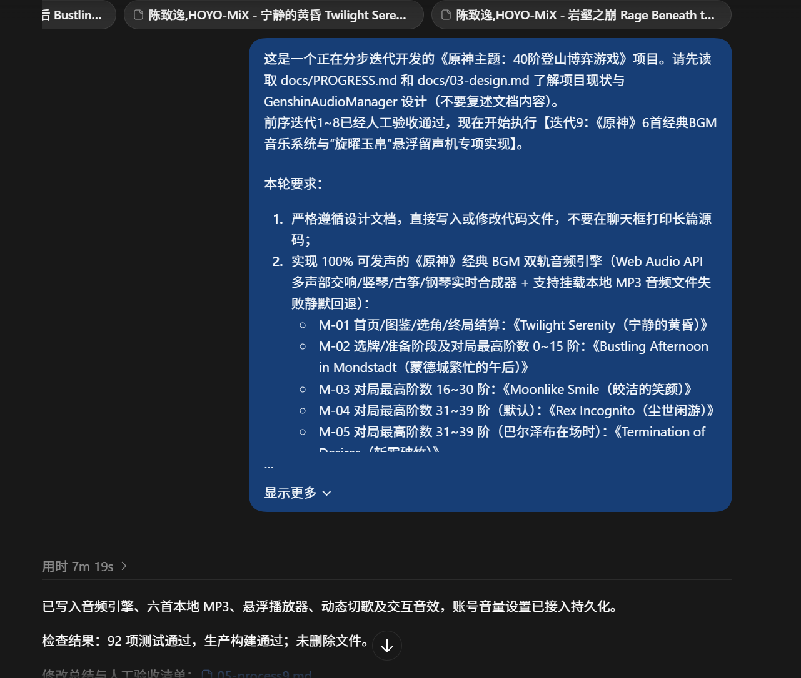

图26　音频专项开发：开发者提供音乐资源和场景映射，AI接入音频引擎、六份本地MP3、播放器、动态切歌、音效及账号音量设置，报告92项测试通过。

音乐任务在已有对战功能上增加场景反馈。开发者提供录音资源，并按首页、选牌准备、登山区间及特定角色定义曲目映射，同时要求支持本地MP3和合成回退。这样，场景状态能够驱动音乐选择，音量、播放和暂停则由玩家控制，游戏主题通过视觉和声音共同呈现。

AI报告完成音频引擎、六份本地MP3、播放器、动态切歌与交互音效，并将账号音量设置接入持久化，阶段测试为92项通过。截图中的“100%可发声”属于任务目标；实际发声、切曲体验与曲目辨认需要结合人工试听判断。该轮把音频能力接入既有工程，随后再通过使用反馈完善界面和播放状态。

**播放器布局与本地曲目信息修正。**

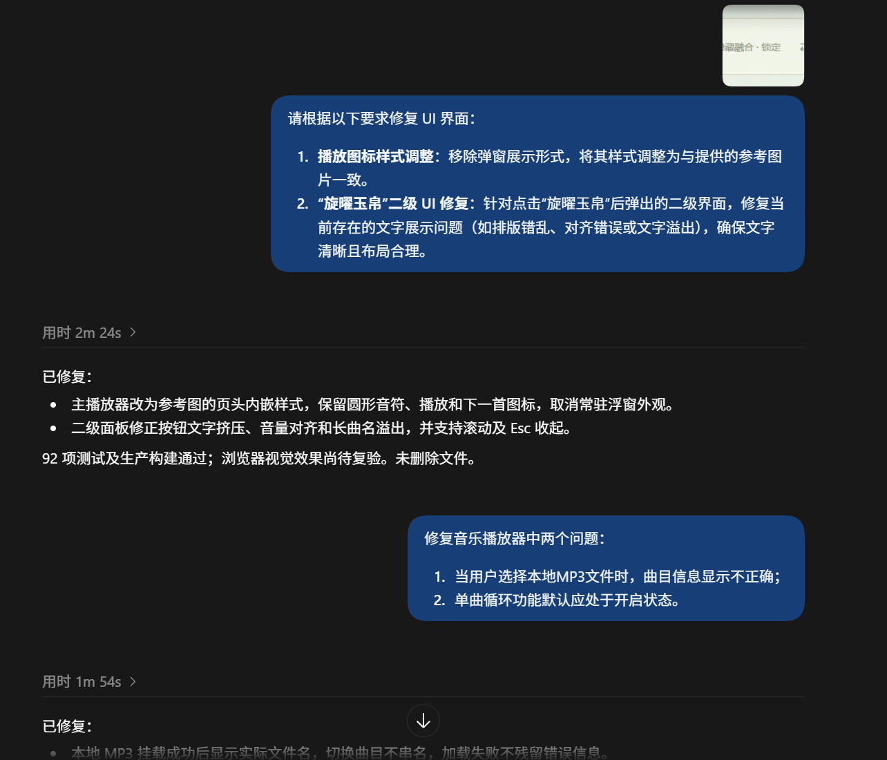

图27　播放器反馈修改：恢复页头内嵌入口，修正二级面板文字、音量对齐和曲名溢出；继续处理本地MP3文件名显示与默认单曲循环。

音乐系统接入后，开发者提供参考图，要求调整播放器入口，并修复二级界面的文字挤压、对齐和溢出。AI将主入口改为页头内嵌样式，保留圆形音符、播放和下一首按钮，二级面板支持滚动与Esc收起。这些改动使播放器与首页导航共同使用空间，并让设置文字保持可读。

下一轮反馈聚焦播放信息与默认行为：选择本地MP3时应显示实际文件名，单曲循环默认开启。截图下部的答复可见文件名显示与切曲信息处理，完整修改记录保存在音频过程文档。这组交互说明，资源成功播放之后，还需要继续核对玩家看到的曲目信息、控制入口和设置状态是否一致。

**实例五：跨设备联机与交互稳定性**

本组案例简述任务与反馈；完整过程和对应代码：[docs/05-process11.md](https://github.com/impureWine/UML/blob/main/docs/05-process11.md)、[server.js](https://github.com/impureWine/UML/blob/main/server.js)、[src/utils/NetworkManager.js](https://github.com/impureWine/UML/blob/main/src/utils/NetworkManager.js)、[src/view/PreparationPanel.js](https://github.com/impureWine/UML/blob/main/src/view/PreparationPanel.js)。

**Node.js与WebSocket联机扩展。**

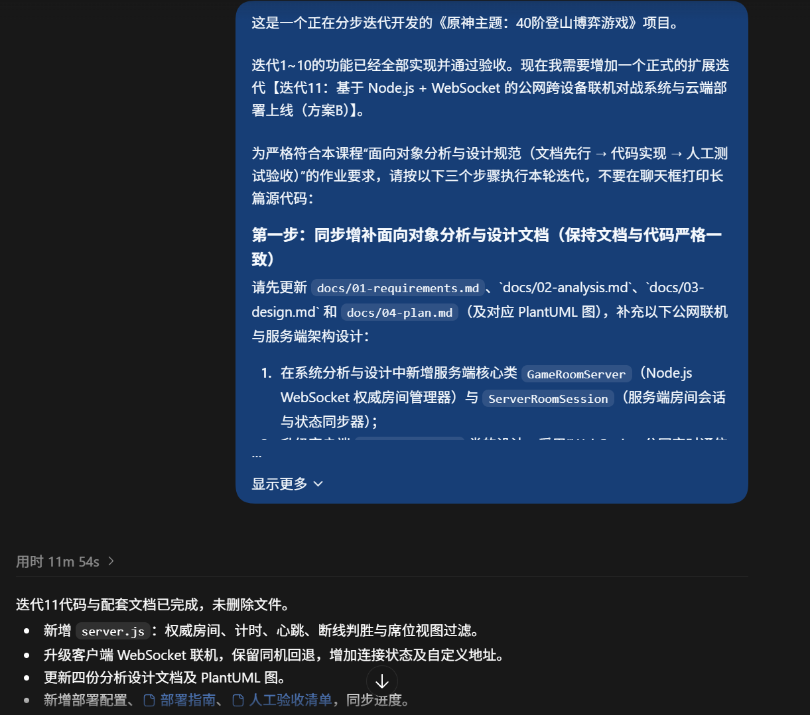

图28　第11轮扩展：先增补分析与设计材料，再加入权威房间、服务端会话、WebSocket通道和部署配置，并保留同机回退。

完成原有迭代后，开发者提出跨设备联机扩展，并继续沿用文档先行、代码实现、人工验收的流程。提示词要求先同步需求、分析、设计、计划及相关UML，再增加GameRoomServer和ServerRoomSession等服务端对象，使原来面向本地和同源窗口的玩法获得服务端房间结构。

AI答复记录了server.js、权威房间、计时、心跳、断线判胜和席位视图过滤，以及客户端WebSocket升级、连接状态、自定义地址和同机回退。部署配置与指南也随之加入。这里展示的是联机代码与配套材料的交付；部署后的跨网络设备运行仍需按实际环境验收，服务端结构的实现与公网发布分别记录。

**联机等待提示与公共牌库余量。**

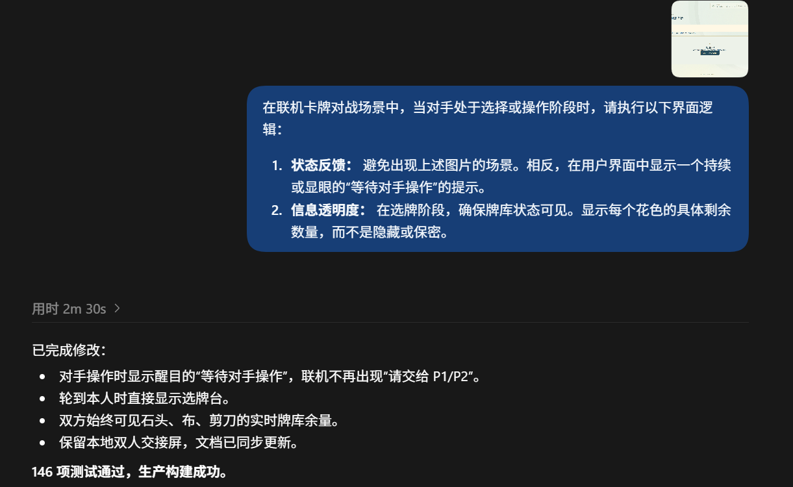

图29　联机体验修正：对手操作时显示等待提示，本人回合直接选牌，双方可见各花色余量；保留本地双人交接，答复报告146项测试通过。

联机运行反馈显示，不同设备固定席位的操作方式需要与同屏双人区分。开发者要求对手操作时显示持续醒目的等待提示，并在取牌阶段公开每种花色的余量。提示词把反馈画面、预期提示与公开数据范围一起说明，为界面和投影规则提供了同步修改依据。

AI将联机选牌改为本人回合直接操作、对手回合显示等待，并保留本地双人交接屏；各花色余量同步公开，阶段测试增至146项。这一修改使联机界面与席位身份相匹配，也将最新的信息公开裁决落实到实际流程。它随后继续通过AI模式和并行操作场景的测试细化等待条件。

**AI视角、黄金技能与回溯结算修正。**

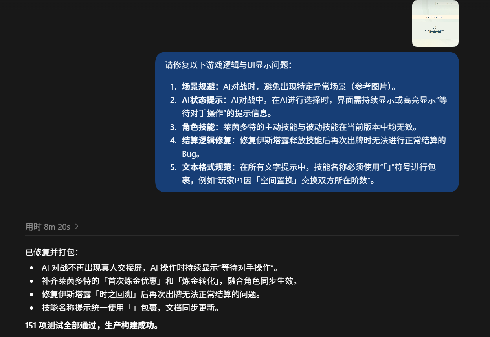

图30　多项反馈修复：调整AI等待视图，补齐黄金能力及融合效果，修正回溯后二次出牌结算，并统一技能名称格式；答复报告151项测试通过。

开发者在继续运行游戏时，将AI选牌界面异常、黄金能力不生效、时间回溯后再次出牌无法正常结算等问题集中反馈，同时规定技能名称使用「」包裹。每项反馈都指向具体场景或行为，使AI能够分别检查模式视角、技能组件和回合尝试状态。

AI答复记录了AI模式取消真人交接、补齐首次炼金优惠与炼金转化、同步融合能力，并修正回溯后的再次结算，阶段测试为151项通过。回溯后仍属于同一回合，但已是新的尝试，因此实现还需要使动画和AI决策识别attemptNo。该实例把实际体验中的问题转化为规则、状态和视图之间的联合修订。

**等待条件与联机重绘稳定性修正。**

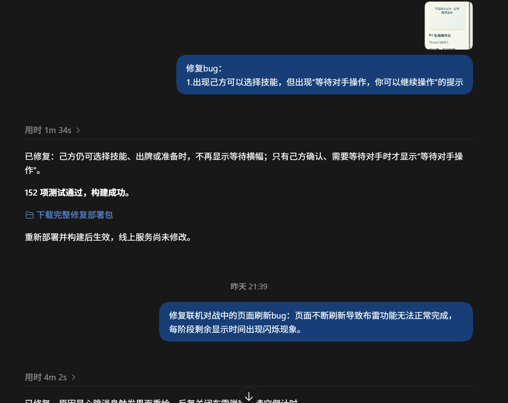

图31　后续交互修正：己方确认后才显示等待，阶段记录152项测试通过；开发者随后反馈联机布雷被刷新打断及倒计时闪烁。

上一轮增加等待提示后，开发者进一步发现：本人仍可选技能、出牌或准备时，页面也出现等待横幅。AI将判断依据改为己方是否已经确认，只有本人完成操作并需要等待对手时才显示横幅，答复报告152项测试和构建通过。提示由此准确对应当前可操作状态，避免玩家误判自己是否还能继续行动。

截图下部继续提出联机页面反复更新、布雷无法完成和倒计时闪烁的问题。结合现有过程文档，后续实现将pong心跳与业务状态通知分开，对重复快照去重，并按本席资源与阶段判断是否重建准备面板。截图展示问题提出，过程文档补充修改机制；弹窗持续性和双端操作连续性仍按人工清单复验。

## 3 人工测试、反馈与修改

### 3.1 测试组织

本节简要说明人工测试路径和阶段验收方式。完整材料与源文件位于GitHub仓库的[docs/acceptance/iteration-01.md](https://github.com/impureWine/UML/blob/main/docs/acceptance/iteration-01.md)、[docs/acceptance/iteration-02.md](https://github.com/impureWine/UML/blob/main/docs/acceptance/iteration-02.md)、[docs/05-process3.md](https://github.com/impureWine/UML/blob/main/docs/05-process3.md)、[docs/05-process6.md](https://github.com/impureWine/UML/blob/main/docs/05-process6.md)。

人工检查围绕完整使用路径展开：注册登录 → 选择模式 → 选角取牌 → 准备 → 技能与出牌 → 移动踩雷 → 终局与战绩。界面检查关注关键按钮、私密遮罩、提示位置和操作连续性；规则检查关注资源守恒、技能次数、回溯及信息隔离。发现问题后，将“操作、预期、实际表现”反馈给AI，再通过修改与回归检查闭合问题。

已有文档记录了早期实际浏览器检查和用户验收确认。例如，迭代1有表单、双窗口、两分辨率记录，迭代2有地图断言和截图；迭代9记载此前1～8已人工验收，迭代10记载迭代9已确认通过。后续增量仍有待复验清单，按各次记录分别保留状态。

**角色展示与地图交互的人工验收。**

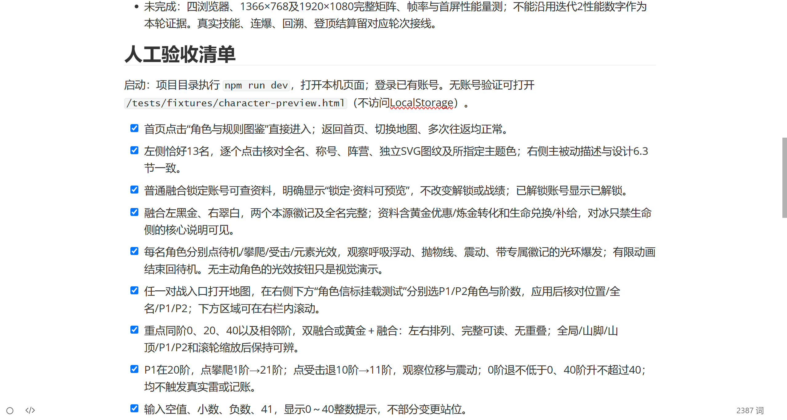

图32　角色与地图人工验收清单：逐项核对13名角色资料、锁定状态、动画、地图挂载、双席排列和阶位输入，截图记录了对应阶段的勾选结果。

这份清单将人工测试落实到可以重复执行的操作。测试者从首页进入图鉴，逐个核对角色姓名、称号、元素图纹与技能描述，再检查锁定角色是否允许预览且不改变真实解锁状态。随后在地图夹具中设置双方角色和阶位，观察同阶、相邻阶以及山脚和山顶时的排列，核对文字是否完整、两席是否重叠。

清单还包含待机、攀爬、受击和元素光效预览，以及空值、小数、负数和越界阶数的输入检查。夹具中的动画与位置变化用于验证展示效果，不触发真实踩雷或战绩写入。截图上方同时保留了当时尚未完成的浏览器与性能检查范围，说明这些勾选结果对应角色展示阶段，后续实战技能与完整对局由相应迭代继续验证。

### 3.2 典型问题闭环

本节简要说明典型问题的原因、修改和验证结果。完整材料与源文件位于GitHub仓库的[docs/05-process3.md](https://github.com/impureWine/UML/blob/main/docs/05-process3.md)、[docs/05-process6.md](https://github.com/impureWine/UML/blob/main/docs/05-process6.md)、[docs/05-process10.md](https://github.com/impureWine/UML/blob/main/docs/05-process10.md)、[docs/05-process11.md](https://github.com/impureWine/UML/blob/main/docs/05-process11.md)、[tests/unit/](https://github.com/impureWine/UML/tree/main/tests/unit)。

| 人工反馈或运行观察 | 原因定位 | 与AI继续交互后的修改 | 结果与证据 |
| --- | --- | --- | --- |
| 房主最后就绪后仍停留大厅 | 异步按钮处理返回后重新绘制大厅，覆盖已进入的选角 | 由Game订阅统一驱动界面；旧大厅绘制检查当前阶段 | 新增5项回归，累计120项通过；真实双窗口复验列入清单 |
| 对手锁牌使本人已选牌消失 | 同步更新重建输入框，checked状态丢失 | 保存本席实体牌ID，在同局、同回合、同尝试且合法时恢复 | 新增11项回归，累计131项通过；跨轮及回溯不恢复旧选择 |
| 所有角色出现通用技能参数 | 面板未按技能组件筛选字段 | 仅渲染当前角色需要的控件，从当前技能区域取参数 | 全11角色面板隔离检查，阶段记录81项通过 |
| 己方仍可操作时出现等待提示 | 提示判断混入对方操作状态 | 依据己方waiting状态，确认或锁定后才显示等待 | online-waiting相关用例覆盖；最新版本仍需设备交互复验 |
| 联机布雷弹窗和勾选被频繁打断 | 心跳或无关同步触发面板重建 | pong只更新延迟；重复快照去重；按本席有效依赖判断重建 | network-render-stability测试覆盖；弹窗持续性列入人工清单 |
| 公网环境音乐和背景加载慢 | 原5秒音频时限小于记录中的下载耗时，背景统一等待 | MP3时限延长至60秒，背景独立就绪显示，保留失败回退 | 过程记录首曲约6.86秒、背景约11.31秒；弱网复验列入清单 |
| 回溯后再次出牌动画或AI动作异常 | 同回合旧动画标识和AI技能标记仍被复用 | 标识加入attemptNo，取消过期动画并重置本次AI决策 | 黄金技能与回溯增量后累计151项通过 |

这些问题体现了人工测试的价值：规则正确之外，还需要检查用户正在执行的操作能否持续完成。AI依据复现路径定位到状态、事件和DOM生命周期，再把问题转化为可重复的回归检查。

**角色素材与铭牌表现的反馈修改。**

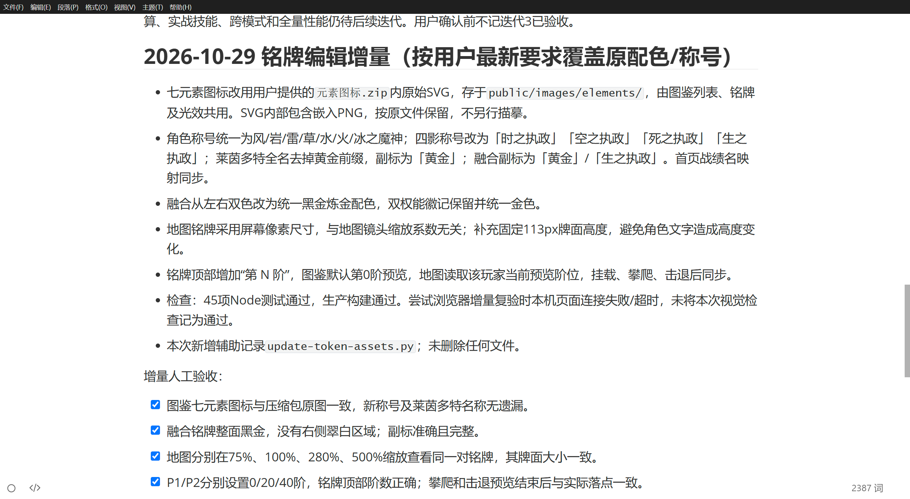

图33　铭牌编辑增量记录：接入用户提供的七元素SVG，统一角色称号与融合配色，补充阶数标签，并列出素材、文字和站位同步的人工检查项。

角色显示经过运行检查后，开发者继续细化素材与命名要求。AI将七元素原始SVG接入图鉴、铭牌及光效，统一魔神和执政称号，并将融合角色调整为黑金风格，同时在铭牌顶部增加当前阶数。修改涉及多处共同显示的数据，因此验收同时核对图鉴、地图与首页战绩名称，检查同一角色在不同入口是否保持一致。

截图还记录当时45项测试和构建通过，而该次浏览器增量复验遇到连接失败或超时，视觉检查未记为通过。下方清单列出后续核对方法，包括素材与原图一致、称号无遗漏、配色正确及阶位同步。它展示了如何把一次视觉反馈转化为实现变更和具体复验条件。截图中的固定屏幕尺寸属于当时方案，后续缩放规则按图34继续修订。

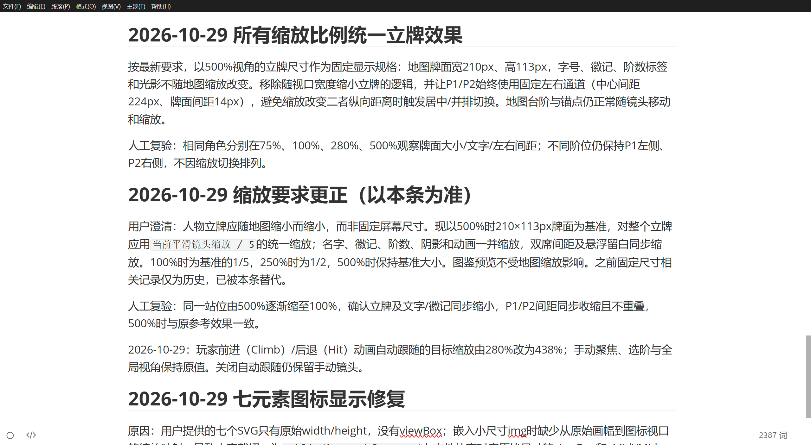

图34　缩放规则澄清：记录从固定屏幕尺寸到随地图等比缩放的调整，以500%视角的210×113像素牌面为基准，文字、徽记、阴影与双席间距同步变化。

开发者在不同镜头比例下观察角色立牌后，进一步明确预期：立牌应随地图缩小而缩小。记录先保留固定尺寸方案，再明确以新的等比缩放要求为准。具体做法是将整个立牌按“当前平滑镜头缩放÷5”统一缩放，使100%视角对应基准尺寸的五分之一、250%对应二分之一，500%保持基准大小。

复验围绕同一站位从500%逐步缩至100%展开，检查名字、徽记、阶数和间距是否同步变化，以及双方是否始终可辨认且不重叠。记录还区分图鉴预览与地图镜头，避免地图缩放影响独立图鉴。这个案例表明，人工反馈需要把“大小合适”进一步转化为基准尺寸、比例关系和观察步骤，才能使AI修改获得明确的验收口径。

**终局展示与战绩保存的人工检查。**

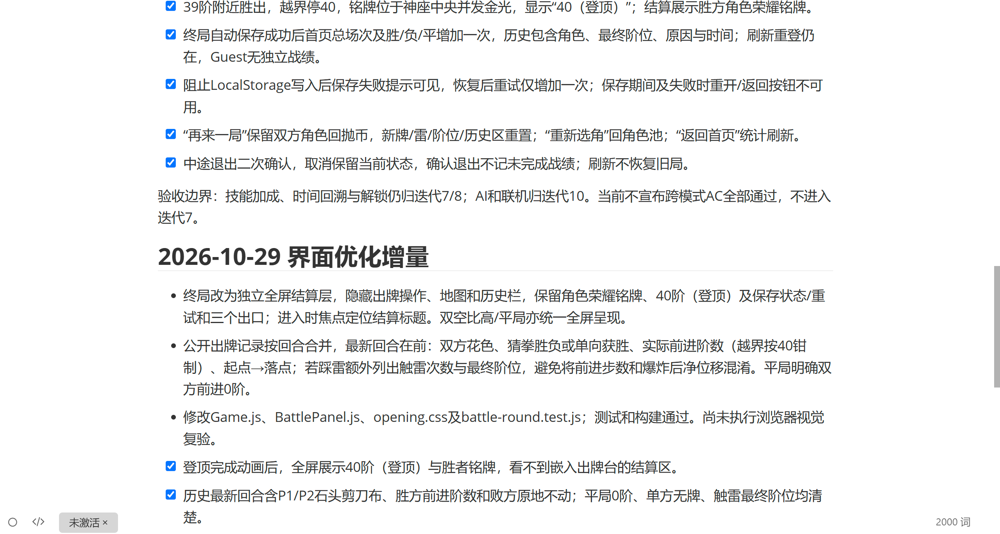

图35　终局与记录验收：核对登顶、战绩保存、失败重试和重新开始，再将终局改为独立全屏展示，按回合解释出牌、前进和踩雷后的实际落点。

测试在39阶附近构造登顶情景，检查越界后停在40阶、胜者铭牌与结果一致，以及保存成功后统计和历史只增加一次。清单还覆盖存储失败后的错误提示、恢复后的重试、再来一局、重新选角和中途退出，使一场对局的结束与下一次操作衔接起来。

开发者随后要求优化终局层和公开记录。修改后的终局采用独立全屏结算，隐藏出牌布局，集中展示登顶结果、角色铭牌和出口；回合记录则明确区分基础前进与踩雷回退，按起点、落点和最终阶位解释结果。截图同时保留了当时的技能与跨模式验收范围，反映出每轮先验证当前功能，再由后续迭代补齐相关场景的测试方式。

### 3.3 本次报告整理时的验证

本节汇总自动测试结果。测试源码见GitHub的[tests/unit/](https://github.com/impureWine/UML/tree/main/tests/unit)，启动命令见[package.json](https://github.com/impureWine/UML/blob/main/package.json)；仓库已有的阶段日志包括[network-stability-test-results.txt](https://github.com/impureWine/UML/blob/main/network-stability-test-results.txt)、[skills-fix-test-results.txt](https://github.com/impureWine/UML/blob/main/skills-fix-test-results.txt)、[waiting-condition-test-results.txt](https://github.com/impureWine/UML/blob/main/waiting-condition-test-results.txt)。本次报告整理生成的report-test-results-20261102.txt、report-build-results-20261102.txt，以及本地deployment-validation-20261102.txt，目前未见于已核对的main分支，作为本地附件保存。

2026年11月2日，在当前工作区执行npm test：155项测试全部通过，失败0项、跳过0项。完整输出保存在项目根目录report-test-results-20261102.txt。该结果说明当前自动用例覆盖的账号、开局、准备、战斗、技能、AI和网络分支通过检查。

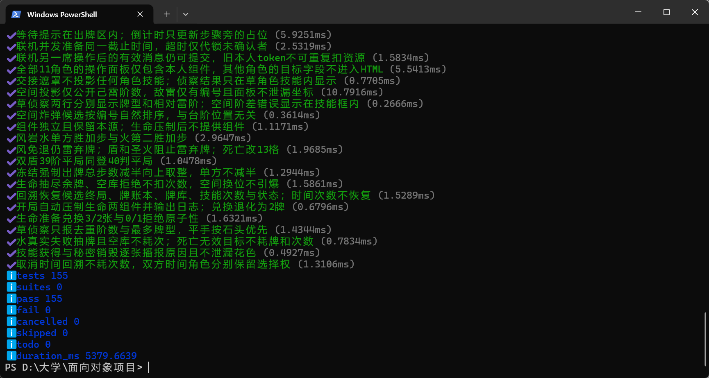

图36　自动测试结果截图：终端汇总显示tests 155、pass 155、fail 0、skipped 0，并列出等待提示、技能面板隔离、秘密信息、资源边界与回溯恢复等测试项目。

截图提供了完整测试汇总的直观证据，上方的用例名称还显示了检查关注的具体行为，例如双方并行准备时的操作令牌、敌方雷坐标隐藏、技能组件来源、回溯恢复和取消回溯不扣次数。绿色通过标记与下方统计共同说明这次运行中已执行的自动用例全部通过；实际音画、不同设备和完整联机体验继续按人工验收清单检查。


项目原有deployment-validation-20261102.txt同样记录155项通过。本报告另行运行测试，确认文档整理时的工作区状态。构建结果以随本报告保存的report-build-results-20261102.txt为准。

### 3.4 后续人工复验的具体路径

本节简要说明最新版本需继续执行的人工复验场景。完整材料与源文件位于GitHub仓库的[docs/05-process11.md](https://github.com/impureWine/UML/blob/main/docs/05-process11.md)、[docs/06-deployment.md](https://github.com/impureWine/UML/blob/main/docs/06-deployment.md)。

| 场景 | 操作 | 预期结果 | 记录状态 |
| --- | --- | --- | --- |
| 联机开局 | 两端分别先、后及接近同时就绪 | 两端均进入选角，不被旧大厅覆盖 | 待最新版本双端复验 |
| 出牌连续性 | A选牌但不锁，B锁牌；交换席位重复 | A选中状态保留且可提交；齐锁前不显示对方花色 | 自动回归已覆盖，双端待复验 |
| 布雷稳定性 | 弹窗保持多个心跳周期，对方连续操作 | 本人弹窗、输入和合法选择保持；阶段结束时关闭旧操作 | 自动回归已覆盖，双端待复验 |
| 回溯 | 使用时间能力撤销本轮，重新技能确认和出牌 | 状态恢复正确，新尝试正常动画结算，不提前记战绩 | 自动回归已覆盖，完整交互待复验 |
| 跨网络对战 | 两设备经同一可信HTTPS地址建房加入 | 固定席位、倒计时、秘密投影和断开处理符合规则 | 待部署后实测 |
| 最新音画体验 | 弱网播放六曲，检查不同地图区间和音量 | 已就绪背景及时显示，音频成功或明确回退，关键控件可用 | 待最新版本实机复验 |

## 4 项目成果与开发体会

项目形成了一套连接账号、开局、资源准备、回合对战和结果保存的游戏流程，并使本地双人、AI与联机复用核心规则。面向对象方法最直接的作用，是将玩家、牌库、棋盘、角色能力和信息投影分配给不同对象，使复杂规则能够分别验证，再由控制器组织为完整对局。

AI协作的有效方式，是给出可观察的结果和明确约束。例如，“等待提示更合理”需要具体化为“本人未确认时可以继续操作，确认后才显示等待”；“回溯正确”需要具体化为“恢复哪些对象、哪些次数不恢复、何时允许写入战绩”。这样的任务描述使AI输出能够通过程序和界面共同检查。

本项目的主要成果在于将规则、可见信息和交互阶段统一起来：同一套规则支持三种对战方式，席位投影控制私有数据，回合快照支持撤销，反馈记录解释实际结果。现有155项自动测试为持续修改提供回归依据，人工测试则进一步核对视图、音画与真实设备协作。二者结合，构成可追溯的AI辅助开发过程。

## 附录A 运行与检查

本节简要说明本地启动与检查命令。完整材料与源文件位于GitHub仓库的[docs/06-deployment.md](https://github.com/impureWine/UML/blob/main/docs/06-deployment.md)、[package.json](https://github.com/impureWine/UML/blob/main/package.json)、[server.js](https://github.com/impureWine/UML/blob/main/server.js)。

运行环境要求Node.js 22.12.0或更高版本。已有依赖的工作区可执行以下命令：

```powershell
npm run dev
```

浏览器访问http://127.0.0.1:5173/。本地完整前后端运行可先执行npm run build，再执行npm start，访问http://localhost:3000；同一服务提供静态页面、/health与/ws。新环境的依赖安装见项目运行文档。

```powershell
npm test
npm run build
npm start
```

账号数据按浏览器同源保存，5173、4173和3000端口之间的数据空间不同。三种入口下需要分别注册或登录对应来源的账号。公网部署流程见06-deployment.md。

## 附录B GitHub源文件与证据索引

| 源文件位置 | 完整内容与用途 |
| --- | --- |
| [docs/01-requirements.md](https://github.com/impureWine/UML/blob/main/docs/01-requirements.md) | 完整需求、业务规则、功能与验收编号 |
| [docs/01-usecasediagram.puml](https://github.com/impureWine/UML/blob/main/docs/01-usecasediagram.puml) | 详细用例图源文件 |
| [docs/02-analysis.md](https://github.com/impureWine/UML/blob/main/docs/02-analysis.md) | 完整对象分析与需求对应关系 |
| [docs/02-classdiagram.puml](https://github.com/impureWine/UML/blob/main/docs/02-classdiagram.puml) | 详细类图源文件 |
| [docs/03-design.md](https://github.com/impureWine/UML/blob/main/docs/03-design.md) | 模块、类、接口和关键流程设计 |
| [docs/04-plan.md](https://github.com/impureWine/UML/blob/main/docs/04-plan.md)、[docs/PROGRESS.md](https://github.com/impureWine/UML/blob/main/docs/PROGRESS.md) | 分轮开发计划和历史进度 |
| [docs/](https://github.com/impureWine/UML/tree/main/docs) | 05-process系列逐轮过程文档与验收说明 |
| [docs/11-network.puml](https://github.com/impureWine/UML/blob/main/docs/11-network.puml)、[docs/06-deployment.md](https://github.com/impureWine/UML/blob/main/docs/06-deployment.md) | 网络结构图源文件与部署说明 |
| [src/](https://github.com/impureWine/UML/tree/main/src)、[server.js](https://github.com/impureWine/UML/blob/main/server.js) | 前端业务、模型、界面、音频与服务端源码 |
| [tests/unit/](https://github.com/impureWine/UML/tree/main/tests/unit)、[tests/fixtures/](https://github.com/impureWine/UML/tree/main/tests/fixtures) | 自动测试源码与人工检查夹具 |
| [docs/acceptance/](https://github.com/impureWine/UML/tree/main/docs/acceptance) | 早期验收记录及原有截图 |
| [network-stability-test-results.txt](https://github.com/impureWine/UML/blob/main/network-stability-test-results.txt)、[waiting-condition-test-results.txt](https://github.com/impureWine/UML/blob/main/waiting-condition-test-results.txt) | 仓库已保存的阶段测试输出 |
| 本地docs/report-assets/ | 本报告使用的36张图片；尚未上传至已核对的main分支 |
| 本地report-test-results-20261102.txt、report-build-results-20261102.txt | 本次报告整理时的测试与构建输出；尚未上传至已核对的main分支 |
| 本地deployment-validation-20261102.txt | 既有本地验证记录；尚未上传至已核对的main分支 |

本报告按当前实现整理功能，以阶段记录描述历史验收。README和PROGRESS的部分开头段落保留早期迭代状态，引用时结合后续增量记录判断。分析设计阶段的8张截图与代表性AI交互中的14张截图均由开发者提供，说明文字结合截图可见内容和项目过程文档整理。GitHub链接按公开仓库main分支核对，正文各处的文件名均可点击打开；本地新增附件单独标注。姓名、学号、班级由提交者补齐。

