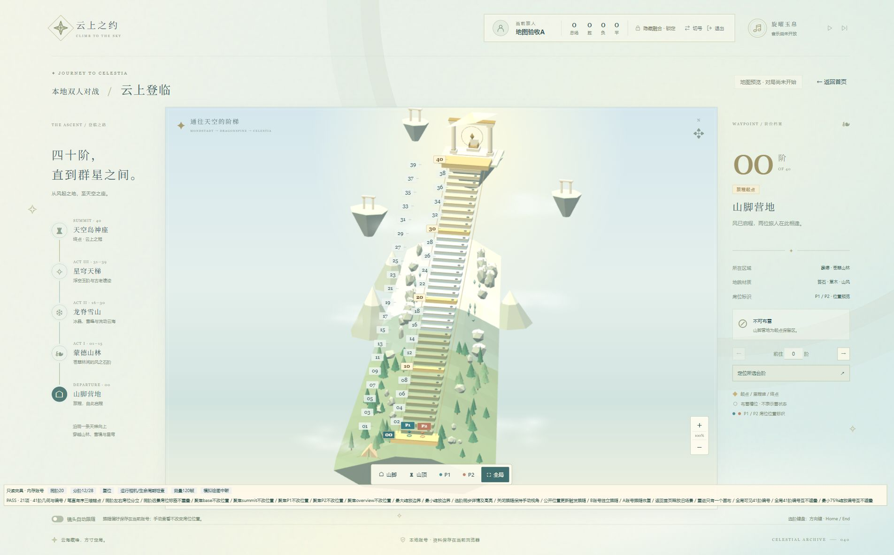
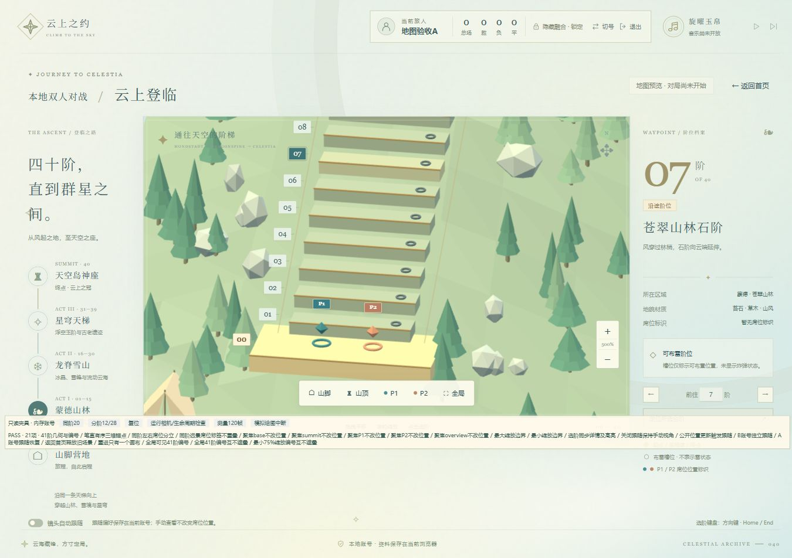
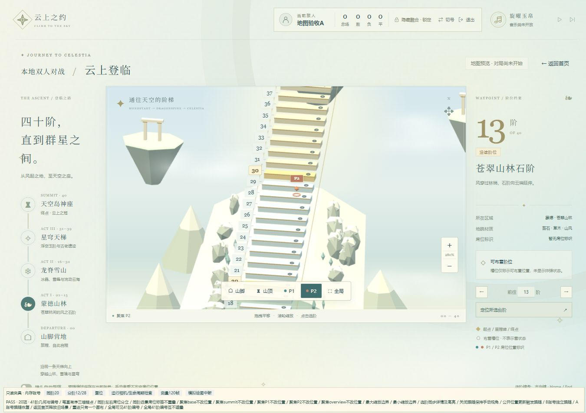
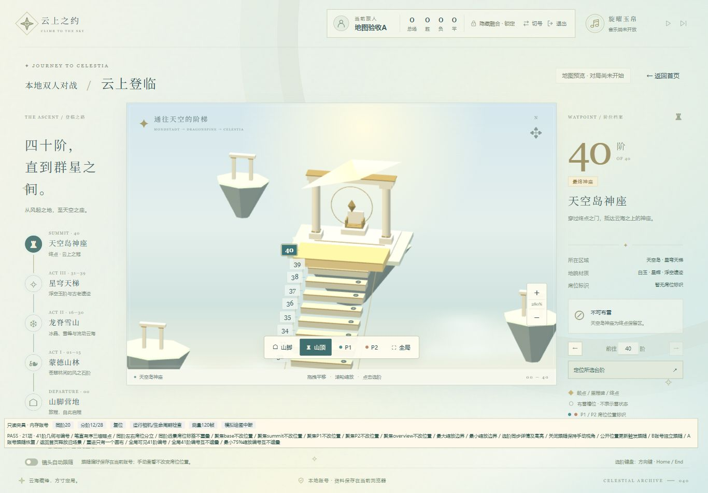

# 迭代2开发者验证记录

日期：2026-10-28。范围仅地图UI。用户人工验收另见 [05-process2.md](../05-process2.md)，尚未填写通过。

## 自动检查

| 检查 | 实际结果 |
| --- | --- |
| `npm.cmd test` | 40 tests / 40 pass / 0 fail，覆盖原账号回归及新增地图/投影/镜头偏好 |
| `npm.cmd run build` | Vite 7.3.7通过，21模块；主脚本57.60kB、地图动态模块553.11kB（gzip140.96kB）、CSS43.09kB |
| 构建提示 | 地图模块超过500kB提示保留；Three.js按地图入口动态加载，未隐藏提示 |
| 独立代码审查 | [审查记录](iteration2-review.md)；发现的编号间距、席位标签间距、键盘跨屏焦点问题已修复 |

## 浏览器夹具

使用当前本地Vite服务与内置Chromium 156，页面为 `http://127.0.0.1:5173/tests/fixtures/map-preview.html`。夹具以Game/GameView实际页面承载地图，用独立内存账号替代AccountManager持久层，不触碰真实LocalStorage。两种目标分辨率都得到 **PASS · 21项**：

1. 41阶几何与编号。
2. 锚点笔直有序、三维坐标正确。
3. 同阶左右三维席位分立。
4. 同阶远景P1/P2屏幕标签不重叠。
5～9. base/summit/P1/P2/overview五种聚焦不改公开站位。
10～11. 最大500%与最小75%缩放边界。
12. 选阶同步详情和高亮。
13. 关闭跟随保持手动视角。
14. 开启跟随后，公开位置更新触发相机定位。
15～16. B账号独立偏好与A账号恢复原值。
17. 返回首页销毁旧场景、移除旧画布。
18. 重进只有一个画布。
19. 全局全部41阶编号可见。
20. 全局41个编号边界盒互不遮叠。
21. 75%最小缩放时编号边界盒互不遮叠。

相机稳定等待按实际时间900ms计算，避免高帧率环境下仅等固定帧数导致误判。这里的内部合同断言与下述真实输入检查互补。

## 实际输入与视觉检查

| 操作 | 观察结果 |
| --- | --- |
| 山脚、山顶、全局按钮 | 平滑定位；近景能看到厚度、台阶顶面、通用槽位、营地及终点门/王座 |
| “分阶12/28”后P1/P2按钮 | 分别到山林12阶与雪山28阶；详情选择与相机焦点互不混淆 |
| 在山顶近景空白处拖拽 | 状态变为“自由视角”；原选中39阶保持不变，无误选 |
| 画布内滚轮向上 | 缩放显示280%→439%，正常放大 |
| 山林近景点击台阶实体 | 点击第13阶顶面，详情显示13并高亮 |
| 山脚0号按End，稳定后ArrowDown | 40号实际获得焦点，随后选中39；跨屏键盘输入继续有效 |
| WebGL上下文中断模拟 | 显示“3D绘图上下文已中断”及重载按钮；重载后错误隐藏，只有一个画布，检查可再次运行 |
| 1366×768 / 1920×1080 | 无横向页面溢出；编号及同阶标签不重叠；页面有正常纵向滚动 |

未发现运行错误或着色器编译错误。人工注入上下文丢失期间出现过 `WEBGL_lose_context extension not supported` 警告，不影响重载；未将该注入警告当作正常地图失败。地图默认页未创建真实对局。真实账号跟随偏好持久化由AccountManager单元测试覆盖，用户跨登录检查保留在人工清单中。

## 本次性能样本

连续120次requestAnimationFrame采样，地图全局视角，设备像素比封顶1.6。选阶同步耗时只计 `selectStep(20)` 的同步处理；未测量至屏幕实际呈现的端到端延时。

| 视口 | 平均帧率 | 帧间隔p95 | 选阶同步 | 绘制调用 |
| --- | --- | --- | --- | --- |
| 1366×768 | 198.3FPS | 5.2ms | 0.50ms | 195 |
| 1920×1080 | 189.0FPS | 5.3ms | 0.50ms | 195 |

UA：`Mozilla/5.0 (Windows NT 10.0; Win64; x64) AppleWebKit/537.36 (KHTML, like Gecko) Chrome/156.0.0.0 Safari/537.36`。

当前内置浏览器可能以高于物理屏幕刷新率的频率调度帧；这些样本只描述本次环境，不能外推为所有电脑或四浏览器性能保证。尚未完成2秒冷启动、100ms端到端反馈、低端显卡及四浏览器完整矩阵；相应全量AC不标为完成。

## 截图

截图为真实WebGL页面；下方工具条属于内存验收夹具，不出现在正常游戏入口。聚焦按钮只改变镜头，详情栏继续表示用户所选台阶。

本轮未删除文件，未实现迭代3及之后的功能。
